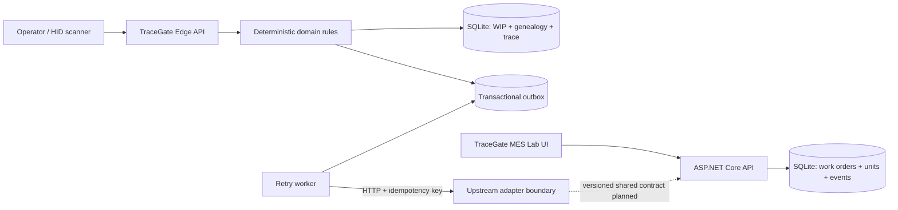
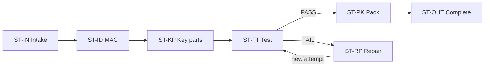
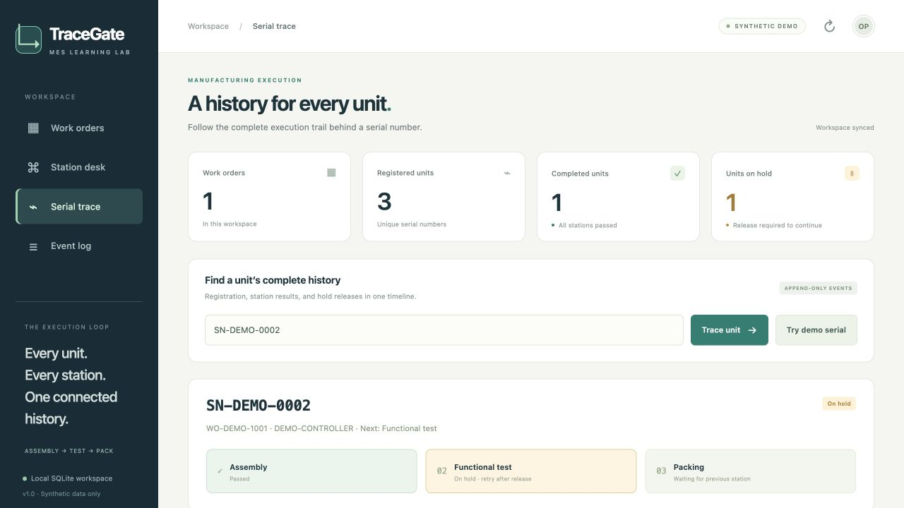

# TraceGate Manufacturing Traceability

**Offline-first edge execution, product genealogy, and an operator-facing MES lab in one evidence-backed portfolio.**

[](https://github.com/weiyu1029/tracegate-edge/actions/workflows/ci.yml)


<p align="center">
  
  <br>
  <sub>Actual running TraceGate MES Lab interface with synthetic data; not an AI-generated mockup.</sub>
</p>

TraceGate is an independent manufacturing software portfolio project. It combines a Python reference runtime for a small Linux edge node with a scoped C# / ASP.NET Core MES learning lab. The repository demonstrates deterministic station rules, serial-level traceability, resilient offline delivery, and a clean operator workflow without using employer, customer, or factory code or data.

## Two components, one portfolio

| Component | Role | Distinctive evidence |
| --- | --- | --- |
| **TraceGate Edge** | Flagship Python reference runtime for a Portenta X8-class edge node | MAC and interface validation, BOM and KPSN genealogy, repair attempts, transactional outbox, retry, dead letter, and replay |
| **TraceGate MES Lab** | C# / .NET 10 companion lab for work-order and serial workflows | Dynamic work orders, unit registration, hold and release, responsive UI, safe CSV export, and 22 real-process integration tests |

The applications are intentionally **not presented as equivalent implementations**. Their routes, APIs, identifiers, and databases currently differ. They share one product story and repository while a versioned cross-component contract remains a future milestone. See the [feature matrix](docs/feature-matrix.md).

## Quick start

### Verify a clean checkout

Install Python 3.10 or later, the .NET 10 SDK, and Node.js, then run the complete verification before starting either demo. The public-release scan intentionally rejects generated SQLite databases, so the demo commands below keep runtime state outside the repository.

```sh
make check-all
```

The root workflow runs the Python reference suite, the .NET lab's 22 black-box integration tests, browser JavaScript syntax validation, and the public-release safety scan.

### Edge runtime

Python 3.10 or later is required. The runtime has no third-party Python package dependencies.

```sh
tracegate_demo_dir="$(mktemp -d)"
TRACEGATE_DATA_DIR="$tracegate_demo_dir" python3 -m tracegate demo
```

Open <http://127.0.0.1:8080>, then run the synthetic journey in another terminal:

```sh
python3 scripts/demo_smoke.py --wait 30 --journey --outage-demo --benchmark 50
```

### .NET MES lab

Install the [.NET 10 SDK](https://dotnet.microsoft.com/download/dotnet/10.0), then run:

```sh
cd labs/dotnet-mes
dotnet restore src/TraceGate.MesLab
mes_lab_dir="$(mktemp -d)"
MES_DB_PATH="$mes_lab_dir/tracegate-mes-lab.db" \
  dotnet run --project src/TraceGate.MesLab
```

Open <http://localhost:5080>. Read the [.NET lab guide](labs/dotnet-mes/README.md) for its API and verification steps.

## The engineering problem

A trustworthy station must answer more than whether a barcode was scanned:

- Is this unit allowed to enter this station now?
- Does a formatted MAC address belong to the correct ACN and network interface?
- Is each installed key part approved for this work order, unique where required, and collected in the correct quantity?
- Are FAIL, defect, repair, and retest preserved as separate attempts rather than overwritten by the latest PASS?
- Do local WIP, events, idempotency records, and pending deliveries remain consistent while upstream is offline?
- Can a retried HTTP request accidentally move the same unit twice?

TraceGate answers those questions with executable vertical slices and tests instead of claiming to be a complete production MES.

## Architecture



An accepted edge transition appends an event, allocates a local audit sequence, updates WIP, queues delivery, and stores the idempotent response in one SQLite transaction. Network delivery happens afterward. An upstream timeout means **pending retry**, not delivered.

The dashed connection is an explicit roadmap boundary: the current .NET lab is co-located but not yet the edge runtime's upstream receiver.

## What is implemented

| Capability | Evidence |
| --- | --- |
| Route and station fail-closed behavior | Python service and HTTP contract tests |
| ACN, MAC, interface, BOM group, alternate-part, KPSN, and quantity validation | Python domain scenarios |
| FAIL -> defect -> repair -> attempt 2 retest | End-to-end edge scenario |
| Event, WIP, outbox, and idempotency in one transaction | SQLite fault-injection rollback tests |
| Durable outbox, causal ordering, retry, lease, dead letter, and manual replay | Outbox and hardening suites |
| Dynamic work orders, serial registration, hold, release, retest, and completion | .NET real-process integration suite |
| Concurrent quantity limits, append-only triggers, restart persistence, and CSV formula safety | .NET tests and validation record |
| Docker / Compose packaging and a small Linux board runbook | Container files and Portenta X8 documentation |

Authentication, TLS, RBAC, real PLC/ERP/MES connectors, high availability, production OTA, and factory-deployment evidence are not implemented. The [claim-evidence matrix](docs/claim-evidence-matrix.md) separates implemented, tested, documented, and planned work.

## Synthetic edge route



Seed units use fictional ACNs, locally administered `02:...` MAC addresses, synthetic work orders, and synthetic key-part serial numbers.

## Demo paths

### Edge outage and recovery

Start the services in Terminal 1:

```sh
tracegate_demo_dir="$(mktemp -d)"
TRACEGATE_DATA_DIR="$tracegate_demo_dir" python3 -m tracegate demo
```

While the services remain running, execute the journey in Terminal 2:

```sh
python3 scripts/demo_smoke.py --wait 30 --journey --outage-demo --benchmark 50
```

The script exercises a wrong MAC association, invalid substitute part, BOM quantity enforcement, idempotent replay, FAIL / repair / retest, offline queueing, recovery, and measured synthetic reads. Cite benchmark output only after running it and preserving its environment and result.

### MES operator workflow

The .NET lab demonstrates:

1. Create a work order with a planned quantity.
2. Register a globally unique serial number.
3. Reject a skipped station without changing state.
4. Record TEST failure and hold the unit.
5. Release with a reason, then require the same-station retest.
6. Complete PACK and inspect the chronological event history.
7. Export a safely escaped CSV.



## Project map

```text
tracegate/                  Python edge domain, SQLite, HTTP, and outbox
tests/                      Edge service, delivery, contract, and hardening tests
scripts/                    Synthetic demo and public-release scanner
labs/dotnet-mes/            C# / ASP.NET Core MES companion lab
docs/images/mes-lab/        Screenshots captured from the running lab
docs/provenance/            Source and consolidation record
docs/                       Architecture, contracts, evidence, security, and roadmap
Dockerfile
docker-compose.yml
Makefile
```

The former `traceflow-mes` project was selectively consolidated as the .NET lab. Its exact source commit, license, renaming, and import decisions are recorded in [provenance](docs/provenance/traceflow-mes.md).

## Run on a Portenta X8-class edge device

The board's host Python may be a reduced build. If it already provides a complete Python development container, use that image instead of modifying the OTA-managed host OS.

```sh
TRACEGATE_IMAGE_ID="$(docker inspect x8-devel --format '{{.Image}}')"
docker run --rm --name tracegate-edge-demo \
  --user "$(id -u):$(id -g)" \
  -p 8080:8080 \
  -v "$PWD:/app" \
  -w /app \
  -e TRACEGATE_DATA_DIR=/app/data \
  --entrypoint python3 \
  "$TRACEGATE_IMAGE_ID" \
  -m tracegate demo
```

Open `http://EDGE-DEVICE-IP:8080/` from the same trusted LAN. This is a smoke-test workflow, not proof of automatic startup, watchdog recovery, power-loss durability, backups, or production readiness.

## Security and publication boundary

Both applications are unauthenticated local demos. Run them only on a personal computer or trusted demo LAN; do not expose them directly to the public internet. Demo reset, upstream toggle, hold release, and outbox replay are not a production administration plane.

AI is reserved for read-only explanation. It may summarize a synthetic trace or explain a reason code, but it cannot authorize PASS, repair, reset, release, or replay. Quality decisions remain deterministic and explicit.

The release scanner checks text files for common secrets, personal paths, email addresses, unsafe IP addresses, sensitive filenames, and local databases. It is one safety gate, not complete DLP; image metadata and OCR, Git history, large files, and binary artifacts still require review.

## Documentation

- [Architecture](docs/architecture.md)
- [Component feature matrix](docs/feature-matrix.md)
- [Domain model and state machines](docs/domain-model.md)
- [Edge API reference](docs/api-reference.md)
- [Offline, outbox, and idempotency semantics](docs/reliability-semantics.md)
- [Multi-language implementation strategy](docs/implementation-strategy.md)
- [3-5 minute edge demo guide](docs/demo-guide.md)
- [.NET MES lab guide](labs/dotnet-mes/README.md)
- [Claim-evidence matrix](docs/claim-evidence-matrix.md)
- [Security and publication checklist](docs/security-publication-checklist.md)
- [Roadmap](docs/roadmap.md)

## Honest scope and licensing

TraceGate demonstrates local transactional integrity, traceability, and outage-aware delivery using synthetic data. It is not a complete MES, QMS, ERP, WMS, equipment platform, ISA-95 certification, or factory deployment.

The imported .NET MES lab retains its original [MIT License](labs/dotnet-mes/LICENSE). No repository-wide license has been added, so the Python reference runtime remains under the repository's existing default copyright status.
