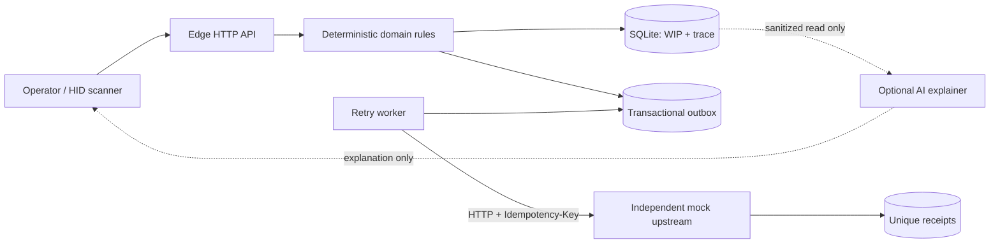
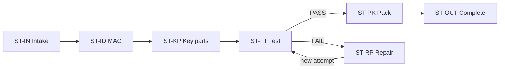

# TraceGate Edge

**Synthetic, local-first manufacturing traceability on a small Linux edge node.**

一個用 Python 3.10+ 與 SQLite 建立的合成製造追溯作品：驗證 route、ACN/MAC/關鍵料關聯，保留 repair/retest 歷史，並以 transactional outbox 在斷線後安全補送事件。

> **Independent educational project / 獨立教育作品**
>
> This repository is not a production MES and does not contain or reproduce any employer, customer, or factory source code, data, schemas, credentials, screenshots, or proprietary workflows. Every work order, unit, route, part, serial number, MAC address, defect, and event is fictional.

## 為什麼做這個

製造站點真正難的不是「掃到條碼就顯示綠色」，而是同時回答：

- 這台產品現在是否真的可以進這一站？
- 格式有效的 MAC 是否屬於正確 ACN 與 interface？
- 裝入的 KPSN 是否是這張工單核准的料、數量也正確？
- FAIL、repair 與 retest 是否保留成不同 attempt，而不是被最後一次 PASS 蓋掉？
- 上游離線時，本地 WIP、事件與待送資料是否保持一致？
- HTTP 重送會不會讓同一台產品過站兩次？

TraceGate 用一個可執行的 vertical slice 回答這些問題，而不是假裝做完整 ERP/MES。

## 一鍵執行

需要 Python 3.10 或更新版本；執行期沒有第三方 Python 套件。

```sh
python3 -m tracegate demo
```

開啟：

- Edge：<http://127.0.0.1:8080/>
- Health：<http://127.0.0.1:8080/api/v1/health>
- Synthetic unit：<http://127.0.0.1:8080/api/v1/units/ACN-DEMO-0001>
- Mock upstream：<http://127.0.0.1:8081/api/v1/health>

另開 terminal 可執行自動化完整旅程：

```sh
python3 scripts/demo_smoke.py --wait 30 --journey
```

完整可複製的 curl 流程與旁白見 [3–5 分鐘 demo guide](docs/demo-guide.md)。

## 現在能證明什麼

| 能力 | 狀態 | Repository evidence |
| --- | --- | --- |
| Route / station fail-closed | Implemented + tested | `tests/test_service.py` |
| ACN、interface、MAC 關聯驗證 | Implemented + tested | 正確、未知、他機與錯 interface 路徑 |
| BOM group、核准替代料、KPSN 唯一性與數量 | Implemented + tested | key-part domain tests |
| FAIL → defect → repair → attempt 2 retest | Implemented + tested | end-to-end service scenario |
| Request-level idempotency 與 payload conflict | Implemented + tested | service / HTTP contract tests |
| Event + WIP + outbox 單一 transaction | Implemented + tested | `tests/test_hardening.py` 的 SQLite trigger fault injection 驗證 event/WIP/outbox/idempotency 一起 rollback |
| Durable outbox across component re-instantiation | Implemented + tested | `tests/test_hardening.py` 重新建立 `Database` / dispatcher 後仍可交付；完整 OS process restart 尚未自動化 |
| Cross-type local causal ordering | Implemented + tested | Migration v2 `audit_sequence`；same-millisecond timeline 與 outbox claim-order test |
| Retry、lease、dead-letter、manual replay | Implemented + tested | `tests/test_outbox.py` 與 stale-worker CAS fencing test |
| Idempotent mock upstream receipts | Implemented + tested | duplicate delivery scenario |
| Health、metrics、unit、trace、outbox API | Implemented + tested | HTTP tests（需允許本機 socket） |
| Docker / Compose packaging | Implemented; target validation required | hardened container files |
| Small Linux edge-board runbook | Documented; v0.2 must be revalidated on target | X8 instructions below |
| TLS、API auth、RBAC、正式 monitoring | Designed; not implemented | [roadmap](docs/roadmap.md) |
| Real PLC/ERP/MES connector | Not implemented | adapter boundary only |
| AI reason-code explainer | Planned, read-only | AI never authorizes PASS |

不要把表中的 `Designed` 或 `Documented` 寫成已完成。公開數字必須來自實際測試；詳見 [claim–evidence matrix](docs/claim-evidence-matrix.md)。

這裡的 durability test 是在相同 SQLite 檔案上重新建立 service/dispatcher components，不等同 kill/reboot、斷電或完整作業系統 process restart 證據；後三者仍需獨立實驗。

## 架構



一個合法過站會在同一筆 SQLite transaction 裡寫入 station event、配發 local `audit_sequence`、更新 WIP、建立 outbox row 並保存 idempotent response。背景 worker 才執行網路 I/O。上游 timeout 是「待重試」，不是「已送達」。Audit sequence 只表示單一 edge SQLite database 內的因果順序，不是跨裝置 global order。

完整說明見 [architecture](docs/architecture.md) 與 [offline/idempotency semantics](docs/reliability-semantics.md)。

## 合成 route



Seed 建立 `ACN-DEMO-0001` 至 `ACN-DEMO-0003`。MAC 使用 locally administered `02:...` 值；work order、part number 與 KPSN 都是公開示範用虛構資料。

## 在 macOS / Linux 開發

```sh
python3 --version
make check
make demo
```

`make check` 會：

1. compile Python source；
2. 跑 `unittest` service、outbox 與 HTTP tests；
3. 執行公開發布掃描，檢查 secrets、個人路徑、email、非文件 IP 與敏感檔案。

如果執行環境禁止開本機 socket，HTTP socket tests 會明確 skip；service 與 outbox 測試仍會執行。公開 release 前應在一般本機或 CI 再跑一次，不能把 skip 當 pass。

Publication scanner 會遍歷 `data/`，並以檔名拒絕 `.db`、`.sqlite*`、私鑰與非範例 `.env`；因此先跑 demo 後產生的本地資料庫也會讓 release gate 失敗。內容掃描只處理不超過 2 MB 的 UTF-8 文字；binary、image、PDF、archive 與超過 2 MB 的檔案本文不會被解讀。公開前仍要用 `git ls-files`、專用 secret/history scanner、圖片/PDF metadata/OCR 與人工檢查補足，不能把這支腳本當成完整 DLP。

也可直接：

```sh
python3 -m unittest discover -s tests -p 'test_*.py' -v
python3 scripts/public_release_check.py .
```

## 完整 outage demo 與實測

先在一個 terminal 執行 `python3 -m tracegate demo`，再在另一個 terminal 執行：

```sh
python3 scripts/demo_smoke.py --wait 30 --journey --outage-demo --benchmark 50
```

腳本會用合成資料檢查錯誤 MAC、冪等 replay、無效替代料、BOM 數量、FAIL/repair/retest、8 個 station events 與離線恢復。最後輸出 `SUMMARY {...}`；benchmark 結果標為 `MEASURED`，不使用預填數字。只有實際執行並保存環境與輸出後，才能引用結果。

## Docker Compose：分離 Edge 與 Upstream

```sh
docker compose up --build -d
python3 scripts/demo_smoke.py --wait 30
docker compose logs -f --tail=100
```

Compose 使用兩個 container 與兩個 volume，讓 Edge 與 mock upstream 成為不同程序及不同資料庫。停止：

```sh
docker compose down
```

上述命令保留 named volumes。不要加 `-v`，除非你已確認要移除合成資料。

## 在 Portenta X8 類小型 Linux Edge 執行

板上 host Python 可能是裁切版；如果已存在完整的 Python development container，應使用它，而不是修改 OTA 管理的 host OS。

在板上的 repository 目錄執行：

```sh
TRACEGATE_IMAGE_ID="$(docker inspect x8-devel --format '{{.Image}}')"
docker run --rm --name tracegate-edge-v02 \
  --user "$(id -u):$(id -g)" \
  -p 8080:8080 \
  -v "$PWD:/app" \
  -w /app \
  -e TRACEGATE_DATA_DIR=/app/data \
  --entrypoint python3 \
  "$TRACEGATE_IMAGE_ID" \
  -m tracegate demo
```

從同一個受信任 LAN 的瀏覽器開啟 `http://EDGE-DEVICE-IP:8080/`。這個 foreground command 適合 smoke test；不要停止或修改裝置既有的系統容器。自動啟動、watchdog、斷電測試與備份是後續工作，不能因為一次啟動成功就宣稱完成。

若要得到較可信的斷線證據，讓 Edge 跑在板上、mock upstream 跑在筆電；設定 `TRACEGATE_MES_URL` 指向筆電的受信任 LAN 位址，再實際停止 upstream 程序。

## CLI modes

```sh
python3 -m tracegate demo       # Edge + mock receiver；包含 demo controls
python3 -m tracegate edge       # 只跑 Edge
python3 -m tracegate mock-mes   # 只跑 synthetic upstream
```

`tracegate.py` 保留為相容入口；新文件與測試以 package CLI 為準。

## API 摘要

| Method | Endpoint | Purpose |
| --- | --- | --- |
| GET | `/api/v1/health` | 版本、schema、DB 與 outbox health |
| GET | `/api/v1/metrics` | 合成產品、WIP、event、defect、delivery counters |
| GET | `/api/v1/units/{acn}` | Current WIP、route、identity、BOM progress |
| GET | `/api/v1/units/{acn}/trace` | 依 local audit sequence 排列的事件、驗證、料件與 repair timeline |
| GET | `/api/v1/outbox` | Delivery queue 與錯誤 |
| POST | `/api/v1/mac/check` | MAC–ACN–interface 驗證 |
| POST | `/api/v1/key-parts/collect` | BOM/KPSN 收集 |
| POST | `/api/v1/stations/complete` | Deterministic station transition |
| POST | `/api/v1/repairs/actions` | Repair evidence |
| POST | `/api/v1/outbox/replay` | 顯式重排失敗 delivery |

完整 payload 與 error contract 見 [API reference](docs/api-reference.md)。

## Configuration

| Environment variable | Default | Meaning |
| --- | --- | --- |
| `TRACEGATE_DATA_DIR` | `./data` | SQLite 資料目錄 |
| `TRACEGATE_HOST` | `0.0.0.0` | Edge bind address |
| `TRACEGATE_PORT` | `8080` | Edge port |
| `TRACEGATE_MES_URL` | local mock URL | Upstream event endpoint |
| `TRACEGATE_MOCK_MES_HOST` | `127.0.0.1` | Mock receiver bind address |
| `TRACEGATE_MOCK_MES_PORT` | `8081` | Mock receiver port |
| `TRACEGATE_OUTBOX_INTERVAL` | `1` | Worker polling seconds |
| `TRACEGATE_OUTBOX_TIMEOUT` | `4` | HTTP timeout seconds |
| `TRACEGATE_OUTBOX_MAX_ATTEMPTS` | `8` | Dead-letter threshold |
| `TRACEGATE_OUTBOX_BATCH` | `20` | Claim batch size |

複製 `.env.example` 只作為設定參考；程式不會自動載入 `.env`。不要把 token 或密碼寫入 repository。

## Project structure

```text
tracegate/                 domain, SQLite, HTTP, outbox and mock receiver
tests/                     service, delivery and HTTP contract tests
scripts/demo_smoke.py      synthetic journey, outage demo and measured benchmark
scripts/public_release_check.py
docs/                      architecture, domain, demo, security and evidence
Dockerfile
docker-compose.yml
Makefile
```

## 安全界線

目前沒有 authentication、authorization 或 TLS，僅限個人電腦或受信任 demo LAN，**不可直接對公網開放**。Demo reset、upstream toggle 與 outbox replay 也不是正式 admin plane。

AI 的設計位置是 read-only explanation：可以解釋 `ROUTE_VIOLATION` 或整理 trace，但不能呼叫 station PASS、repair、reset 或 replay。品質授權只屬於 deterministic domain rules 與明確的人類操作。

發布前請完整執行 [security/publication checklist](docs/security-publication-checklist.md)。

## 文件導覽

- [Architecture](docs/architecture.md)
- [Domain model and state machines](docs/domain-model.md)
- [API reference](docs/api-reference.md)
- [Offline, outbox and idempotency semantics](docs/reliability-semantics.md)
- [Learning concepts → architecture decisions](docs/learning-to-architecture.md)
- [3–5 minute demo guide](docs/demo-guide.md)
- [Day 1–8 public baseline and X8 execution plan](docs/day-1-8-execution-plan.md)
- [Measured local outage-recovery evidence (2026-10-23)](docs/evidence/2026-10-23-local-outage-recovery.md)
- [Claim–evidence matrix](docs/claim-evidence-matrix.md)
- [Security/publication checklist](docs/security-publication-checklist.md)
- [Roadmap](docs/roadmap.md)

## Honest scope

TraceGate Edge 展示的是「正確且可解釋的 edge transaction boundary」，不是完整 MES、QMS、ERP、WMS 或設備平台。它沒有真實 PLC/ERP connector、企業 IAM、HA、正式 OTA、安全認證或工廠部署證據。這些限制是作品可信度的一部分，而不是要藏起來的缺點。
