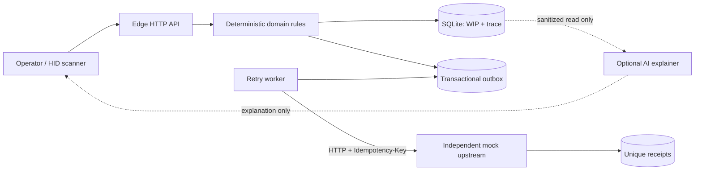
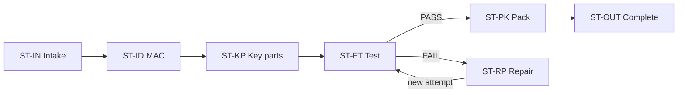

# TraceGate Edge

**Synthetic, local-first manufacturing traceability on a small Linux edge node.**

TraceGate Edge is a synthetic manufacturing traceability portfolio project built with Python 3.10+ and SQLite. It validates route progression and ACN/MAC/key-part relationships, preserves repair and retest history, and uses a transactional outbox to deliver events safely after a network outage.

> **Independent educational project**
>
> This repository is not a production MES and does not contain or reproduce any employer, customer, or factory source code, data, schemas, credentials, screenshots, or proprietary workflows. Every work order, unit, route, part, serial number, MAC address, defect, and event is fictional.

## Why this project exists

The difficult part of a manufacturing station is not displaying a green result after a barcode scan. It is answering several questions at once:

- Is this unit actually allowed to enter this station now?
- Does a correctly formatted MAC address belong to the correct ACN and interface?
- Is the installed KPSN an approved part for this work order, and is the quantity correct?
- Are FAIL, repair, and retest preserved as separate attempts rather than overwritten by the latest PASS?
- Do local WIP, events, and pending delivery records remain consistent while upstream is offline?
- Can an HTTP retry accidentally move the same unit through a station twice?

TraceGate answers these questions with an executable vertical slice instead of pretending to be a complete ERP or MES.

## Quick start

Python 3.10 or later is required. The runtime has no third-party Python package dependencies.

```sh
python3 -m tracegate demo
```

Open:

- Edge: <http://127.0.0.1:8080/>
- Health: <http://127.0.0.1:8080/api/v1/health>
- Synthetic unit: <http://127.0.0.1:8080/api/v1/units/ACN-DEMO-0001>
- Mock upstream: <http://127.0.0.1:8081/api/v1/health>

In another terminal, run the automated end-to-end journey:

```sh
python3 scripts/demo_smoke.py --wait 30 --journey
```

See the [3-5 minute demo guide](docs/demo-guide.md) for a reproducible curl workflow and narration.

## What the current version demonstrates

| Capability | Status | Repository evidence |
| --- | --- | --- |
| Route and station fail-closed behavior | Implemented + tested | `tests/test_service.py` |
| ACN, interface, and MAC association validation | Implemented + tested | Valid, unknown, other-unit, and wrong-interface paths |
| BOM groups, approved alternates, unique KPSNs, and quantities | Implemented + tested | Key-part domain tests |
| FAIL -> defect -> repair -> attempt 2 retest | Implemented + tested | End-to-end service scenario |
| Request-level idempotency and payload conflict detection | Implemented + tested | Service and HTTP contract tests |
| Event, WIP, and outbox in one transaction | Implemented + tested | SQLite trigger fault injection in `tests/test_hardening.py` verifies that event, WIP, outbox, and idempotency writes roll back together |
| Durable outbox across component re-instantiation | Implemented + tested | `tests/test_hardening.py` reconstructs the `Database` and dispatcher and still delivers pending work; a full OS process restart is not yet automated |
| Cross-type local causal ordering | Implemented + tested | Migration v2 `audit_sequence`, same-millisecond timeline test, and outbox claim-order test |
| Retry, lease, dead-letter, and manual replay | Implemented + tested | `tests/test_outbox.py` and stale-worker CAS fencing test |
| Idempotent mock upstream receipts | Implemented + tested | Duplicate-delivery scenario |
| Health, metrics, unit, trace, and outbox APIs | Implemented + tested | HTTP tests, when local sockets are permitted |
| Docker and Compose packaging | Implemented; target validation required | Hardened container files |
| Small Linux edge-board runbook | Documented; v0.2 must be revalidated on target | X8 instructions below |
| TLS, API authentication, RBAC, and production monitoring | Designed; not implemented | [Roadmap](docs/roadmap.md) |
| Real PLC/ERP/MES connector | Not implemented | Adapter boundary only |
| AI reason-code explainer | Planned, read-only | AI never authorizes PASS |

Do not present an item marked `Designed` or `Documented` as complete. Public numbers must come from an actual test run. See the [claim-evidence matrix](docs/claim-evidence-matrix.md).

The durability test reconstructs service and dispatcher components against the same SQLite file. It is not evidence of a kill/reboot, power-loss recovery, or a full operating-system process restart. Those scenarios require separate experiments.

## Architecture



An accepted station transition writes the station event, allocates a local `audit_sequence`, updates WIP, creates an outbox row, and stores the idempotent response in one SQLite transaction. A background worker performs network I/O afterward. An upstream timeout means "pending retry," not "delivered." The audit sequence represents causal order only within one edge SQLite database; it is not a global order across devices.

See [Architecture](docs/architecture.md) and [Offline and idempotency semantics](docs/reliability-semantics.md) for details.

## Synthetic route



The seed data creates `ACN-DEMO-0001` through `ACN-DEMO-0003`. MAC addresses use locally administered `02:...` values. Work orders, part numbers, and KPSNs are fictional public demo data.

## Develop on macOS or Linux

```sh
python3 --version
make check
make demo
```

`make check`:

1. Compiles the Python source.
2. Runs the `unittest` service, outbox, and HTTP tests.
3. Runs the public-release scanner for secrets, personal paths, email addresses, non-documentation IP addresses, and sensitive files.

If the execution environment blocks local sockets, the HTTP socket tests explicitly skip; service and outbox tests still run. Run the suite again on a normal local machine or in CI before a public release. A skipped test is not a pass.

The publication scanner traverses `data/` and rejects `.db`, `.sqlite*`, private keys, and non-example `.env` files by filename. A local database generated by the demo therefore causes the release gate to fail. Content scanning inspects only UTF-8 text files no larger than 2 MB; it does not interpret binary files, images, PDFs, archives, or larger files. Before publication, supplement this script with `git ls-files`, a dedicated secret/history scanner, image and PDF metadata/OCR inspection, and a manual review. Do not treat this script as complete DLP.

You can also run:

```sh
python3 -m unittest discover -s tests -p 'test_*.py' -v
python3 scripts/public_release_check.py .
```

## Complete outage demo and measurement

Start `python3 -m tracegate demo` in one terminal, then run this command in another:

```sh
python3 scripts/demo_smoke.py --wait 30 --journey --outage-demo --benchmark 50
```

The script uses synthetic data to check an incorrect MAC association, idempotent replay, an invalid substitute part, BOM quantity enforcement, FAIL/repair/retest, eight station events, and offline recovery. It prints `SUMMARY {...}` at the end. Benchmark output is labeled `MEASURED` and contains no prefilled numbers. Cite a result only after running the measurement and saving its environment and output.

## Docker Compose: separate Edge and Upstream

```sh
docker compose up --build -d
python3 scripts/demo_smoke.py --wait 30
docker compose logs -f --tail=100
```

Compose uses two containers and two volumes, so Edge and the mock upstream run as separate processes with separate databases. To stop them:

```sh
docker compose down
```

This command preserves named volumes. Do not add `-v` unless you have confirmed that the synthetic data should be removed.

## Run on a Portenta X8-class Linux edge device

The board's host Python may be a reduced build. If the device already provides a complete Python development container, use it instead of modifying the OTA-managed host OS.

From the repository directory on the board:

```sh
TRACEGATE_IMAGE_ID="$(docker inspect x8-devel --format '{{.Image}}')"
docker run --rm --name tracegate-edge-v02 \
  --user "$(id -u):$(id -g)" \
  -p 8080:8080 \
  -v "$PWD:/app" \
  -w /app \
  -e TRACEGATE_DATA_DIR=/app/data \
  --entrypoint python3 \
  "$TRACEGATE_IMAGE_ID" \
  -m tracegate demo
```

From a browser on the same trusted LAN, open `http://EDGE-DEVICE-IP:8080/`. This foreground command is appropriate for a smoke test. Do not stop or modify the device's existing system containers. Automatic startup, a watchdog, power-loss testing, and backups are future work; one successful startup does not prove those capabilities.

For stronger outage evidence, run Edge on the board and the mock upstream on a laptop. Set `TRACEGATE_MES_URL` to the laptop's trusted-LAN address, then stop the upstream process in real time.

## CLI modes

```sh
python3 -m tracegate demo       # Edge + mock receiver, including demo controls
python3 -m tracegate edge       # Edge only
python3 -m tracegate mock-mes   # Synthetic upstream only
```

`tracegate.py` remains as a compatibility entry point. New documentation and tests use the package CLI.

## API summary

| Method | Endpoint | Purpose |
| --- | --- | --- |
| GET | `/api/v1/health` | Version, schema, database, and outbox health |
| GET | `/api/v1/metrics` | Synthetic product, WIP, event, defect, and delivery counters |
| GET | `/api/v1/units/{acn}` | Current WIP, route, identity, and BOM progress |
| GET | `/api/v1/units/{acn}/trace` | Events, validation, components, and repair timeline ordered by local audit sequence |
| GET | `/api/v1/outbox` | Delivery queue and errors |
| POST | `/api/v1/mac/check` | MAC-ACN-interface validation |
| POST | `/api/v1/key-parts/collect` | BOM/KPSN collection |
| POST | `/api/v1/stations/complete` | Deterministic station transition |
| POST | `/api/v1/repairs/actions` | Repair evidence |
| POST | `/api/v1/outbox/replay` | Explicit replay of failed delivery |

See the [API reference](docs/api-reference.md) for complete payload and error contracts.

## Configuration

| Environment variable | Default | Meaning |
| --- | --- | --- |
| `TRACEGATE_DATA_DIR` | `./data` | SQLite data directory |
| `TRACEGATE_HOST` | `0.0.0.0` | Edge bind address |
| `TRACEGATE_PORT` | `8080` | Edge port |
| `TRACEGATE_MES_URL` | local mock URL | Upstream event endpoint |
| `TRACEGATE_MOCK_MES_HOST` | `127.0.0.1` | Mock receiver bind address |
| `TRACEGATE_MOCK_MES_PORT` | `8081` | Mock receiver port |
| `TRACEGATE_OUTBOX_INTERVAL` | `1` | Worker polling interval in seconds |
| `TRACEGATE_OUTBOX_TIMEOUT` | `4` | HTTP timeout in seconds |
| `TRACEGATE_OUTBOX_MAX_ATTEMPTS` | `8` | Dead-letter threshold |
| `TRACEGATE_OUTBOX_BATCH` | `20` | Claim batch size |

Copy `.env.example` only as a configuration reference; the application does not load `.env` automatically. Never commit tokens or passwords.

## Project structure

```text
tracegate/                 domain, SQLite, HTTP, outbox and mock receiver
tests/                     service, delivery and HTTP contract tests
scripts/demo_smoke.py      synthetic journey, outage demo and measured benchmark
scripts/public_release_check.py
docs/                      architecture, domain, demo, security and evidence
Dockerfile
docker-compose.yml
Makefile
```

## Reference implementation and future languages

The current Python implementation is the executable reference implementation and the source of truth for domain behavior, API contracts, migrations, tests, and evidence. Future language implementations may be added as separate, clearly labeled implementations, adapters, or services after they pass the contract and scenario tests appropriate to their stated role. A full alternative implementation must pass the complete conformance suite before claiming parity. Likely candidates include TypeScript for operator-facing clients, Rust or Go for constrained edge services, and C/C++ for hardware bridges. A language name in the roadmap does not mean it is currently supported, and no port should replace the reference behavior without equivalent evidence.

See the [multi-language implementation strategy](docs/implementation-strategy.md) for the planned repository layout, conformance requirements, and evidence standards for future ports.

## Security boundary

The current version has no authentication, authorization, or TLS. Run it only on a personal computer or a trusted demo LAN; **do not expose it directly to the public internet**. Demo reset, upstream toggle, and outbox replay are not a production administration plane.

AI is positioned as a read-only explainer. It may explain `ROUTE_VIOLATION` or summarize a trace, but it cannot invoke station PASS, repair, reset, or replay. Quality authorization belongs exclusively to deterministic domain rules and explicit human actions.

Before publication, complete the [security and publication checklist](docs/security-publication-checklist.md).

## Documentation

- [Architecture](docs/architecture.md)
- [Domain model and state machines](docs/domain-model.md)
- [API reference](docs/api-reference.md)
- [Offline, outbox, and idempotency semantics](docs/reliability-semantics.md)
- [Learning concepts to architecture decisions](docs/learning-to-architecture.md)
- [Multi-language implementation strategy](docs/implementation-strategy.md)
- [3-5 minute demo guide](docs/demo-guide.md)
- [Day 1-8 public baseline and X8 execution plan](docs/day-1-8-execution-plan.md)
- [Measured local outage-recovery evidence (2026-10-23)](docs/evidence/2026-10-23-local-outage-recovery.md)
- [Claim-evidence matrix](docs/claim-evidence-matrix.md)
- [Security and publication checklist](docs/security-publication-checklist.md)
- [Roadmap](docs/roadmap.md)

## Honest scope

TraceGate Edge demonstrates a correct and explainable edge transaction boundary. It is not a complete MES, QMS, ERP, WMS, or equipment platform. It has no real PLC/ERP connector, enterprise IAM, high availability, production OTA process, security certification, or factory-deployment evidence. These limits are part of the project's credibility, not shortcomings to hide.
