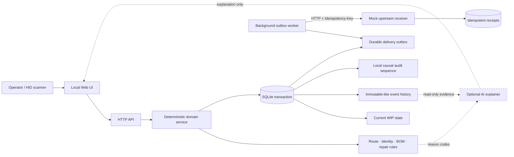
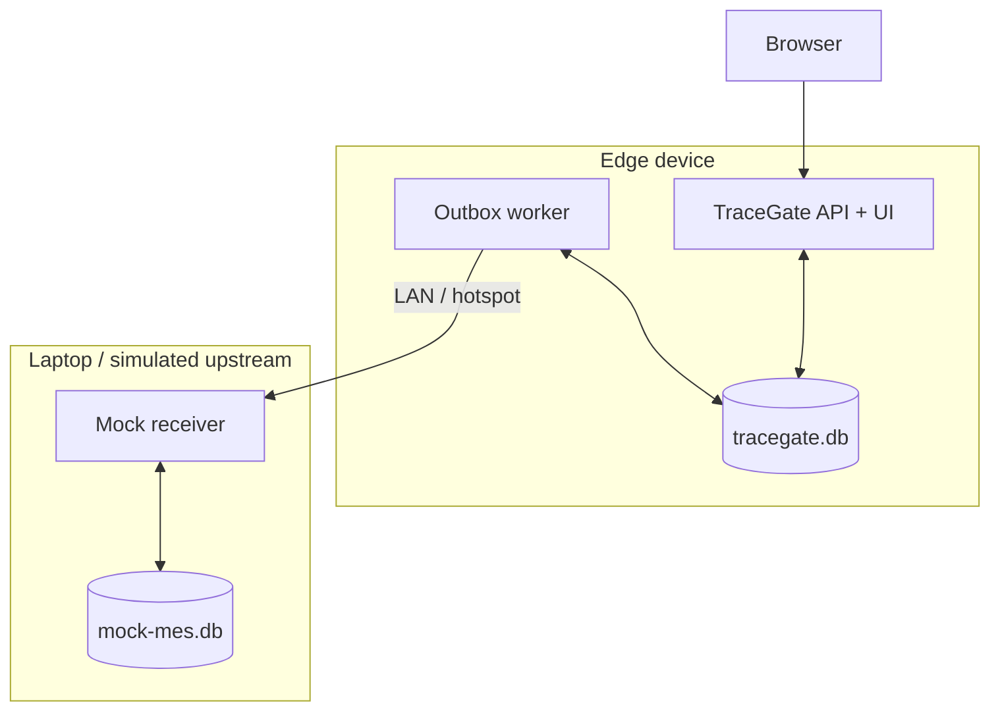
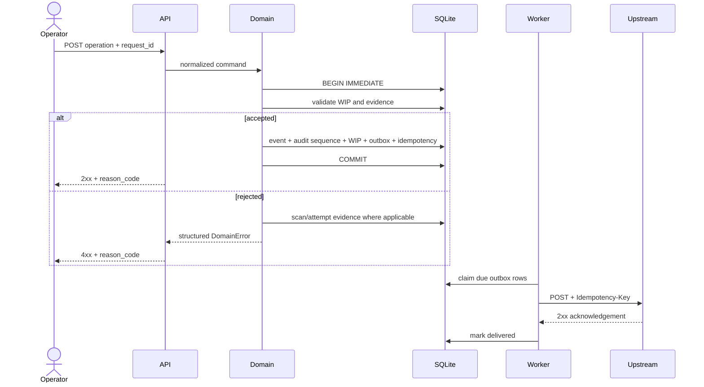
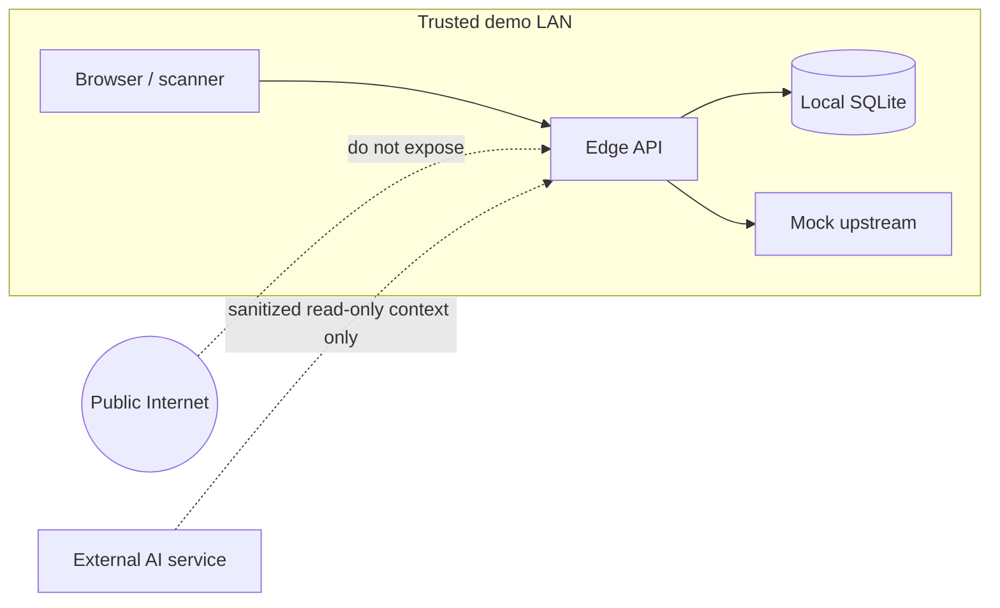

# TraceGate Edge 架構

TraceGate Edge 是一個 **local-first、可離線、全合成資料**的製造追溯參考實作。它用來展示邊緣站點如何在網路不穩時仍執行確定性的製程規則、留下可稽核紀錄，並在連線恢復後安全補送事件。

> 這是獨立開發的教育與作品集專案，不是正式 MES，也不代表任何公司、工廠或客戶的系統。所有名稱、料號、序號、MAC、流程及資料皆為虛構。

## 設計目標

- **本地先決策**：站點能在上游暫時中斷時繼續執行已下載的規則。
- **失敗關閉（fail closed）**：資料不完整、站序錯誤、身份不符或需求未滿足時拒絕過站。
- **完整追溯**：輸入嘗試、驗證、站點事件、維修及傳送狀態可分開查證。
- **可重送、不重做**：API 與上游接收端以冪等鍵避免重複操作。
- **可在小型邊緣電腦執行**：執行期只使用 Python 標準函式庫與 SQLite。
- **AI 不掌握品質閘門**：AI 可以摘要或解釋既有結果，但不能核准 `PASS`、改寫 WIP 或繞過規則。

## 系統全貌

## 部署拓撲

正式展示應把「站點」與「上游」當成兩個故障域。開發時可以在同一台電腦跑兩個程序；作品展示時可讓 Edge 跑在邊緣板、Mock Upstream 跑在筆電，才能證明中斷與恢復不是單一程序裡的假開關。

## 元件責任

| 元件 | 責任 | 明確不做的事 |
| --- | --- | --- |
| Web UI | 收集掃描、顯示目前站序、原因碼與追溯 | 不自行決定 PASS |
| HTTP API | 驗證 JSON、回傳一致錯誤、承接 request ID | 不繞過 domain service |
| Domain service | ACN、MAC、關鍵料、站序、維修與冪等規則 | 不依賴 UI 狀態 |
| SQLite | 交易、WIP、事件、local audit sequence、outbox、receipt | 不等同企業級中央資料庫或跨節點排序服務 |
| Outbox worker | 租借待送事件、退避重試、交付或死信 | 不把網路逾時視為業務成功 |
| Mock receiver | 模擬上游接收與冪等回覆 | 不冒充真正 MES |
| AI explainer（未啟用） | 用既有事件與原因碼產生人類可讀摘要 | **永不核准 PASS、改站序、寫 WIP** |

## 寫入路徑與交易邊界

一個過站請求的關鍵寫入必須在同一個 SQLite `BEGIN IMMEDIATE` 交易中完成：

1. 檢查 `request_id` 是否已執行。
2. 鎖定並讀取目前 WIP。
3. 驗證產品、工單、route/version、站序及前置證據。
4. 寫入 domain record（例如 `station_events`）並在 `audit_log` 配發 local `audit_sequence`。
5. 更新 `wip_state`（或保持原狀並寫失敗結果）。
6. 寫入 `delivery_outbox`。
7. 儲存相同請求的冪等回應。
8. 一次 commit；任一步失敗則全部 rollback。

這個邊界避免「WIP 已前進但事件沒有留下」或「事件留下但永遠不會被補送」的半完成狀態。Schema migration v2 的 `audit_log.audit_sequence` 也在同一 domain transaction 中配發，讓不同 record types 在單一 SQLite database 內具有可重現的因果順序。

## 讀取模型

- `GET /api/v1/units/{acn}`：目前工單、route、WIP、站序及已綁定身份摘要。
- `GET /api/v1/units/{acn}/trace`：依 local `audit_sequence` 排列站點事件、驗證、關鍵料及維修紀錄；timestamp 只作顯示與 legacy fallback。
- `GET /api/v1/health`：程序及資料庫是否可服務。
- `GET /api/v1/metrics`：產品、WIP、event、defect 與 delivery 的合成計數。
- `GET /api/v1/outbox`：待送、重試、死信與已送達的 delivery rows。

Mock receiver 的健康狀態由它自己的 `GET /api/v1/health` 提供。實際端點以目前版本的 API 測試為準；上述名稱若在整合前變更，必須同步更新 README、demo guide 與測試。

## 信任邊界

目前版本沒有企業身份驗證、TLS 終止、密鑰輪替或多租戶隔離。因此只能在受信任的個人開發網路中展示，不應直接對公網開放。

## 核心不變量

1. 一個 ACN 同一時間只有一個目前 WIP 狀態。
2. 一個 `request_id` 只能對應一份規範化後的 payload；不同 payload 重用同一 ID 必須拒絕。
3. 站序不符不能前進 WIP。
4. 僅格式正確的 MAC 不代表關聯正確；必須同時符合 ACN 與 interface。
5. 關鍵料必須屬於該工單、該站點允許的群組，且 KPSN 不可重複綁定。
6. 測試 FAIL 進入 repair 分支；合法 repair 完成後產生新的 attempt，再回到 retest。
7. `PASS` 的業務交易必須與 outbox 記錄同時落盤。
8. 上游逾時是「未知／待重試」，不是「送達成功」。
9. AI 輸出永遠不是製程授權依據。
10. `audit_sequence` 只代表一個 SQLite database／edge device 內的提交因果順序，不代表跨裝置的全域時間或 global order。

## 取捨

- SQLite 適合單站點、低部署成本與可攜展示；不代表多站高併發的最終資料層。
- 標準函式庫 HTTP server 降低板端依賴，但沒有成熟框架的 middleware 與 schema 生態。
- 單機 durable outbox 能處理短暫斷線；如果儲存裝置毀損，仍需要備份或複寫策略。
- 「可重試 + 冪等接收」提供 effectively-once 效果；分散式網路中不能誠實宣稱真正 exactly-once。

相關文件：

- [領域模型](domain-model.md)
- [可靠性語意](reliability-semantics.md)
- [學習概念到架構的對應](learning-to-architecture.md)
- [展示腳本](demo-guide.md)
- [安全與公開檢查表](security-publication-checklist.md)
