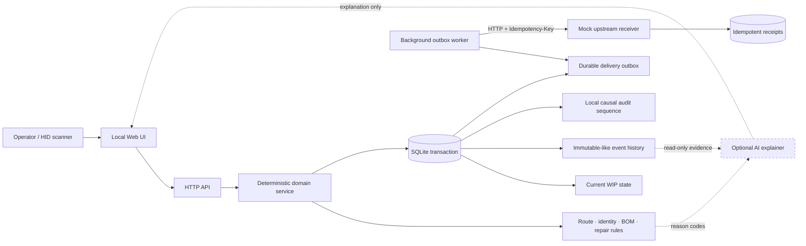
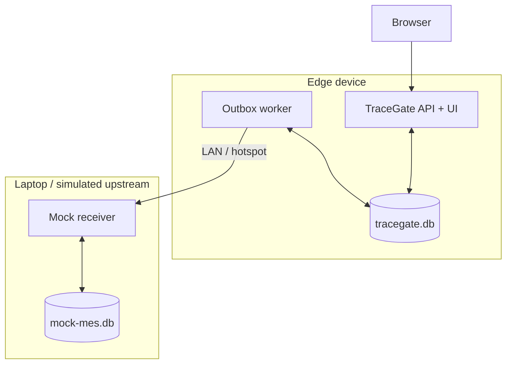
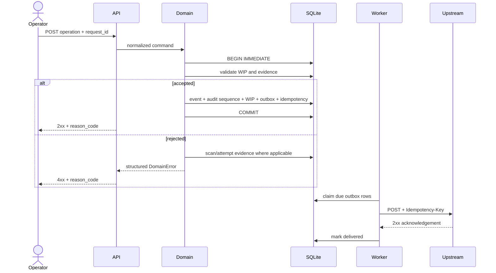
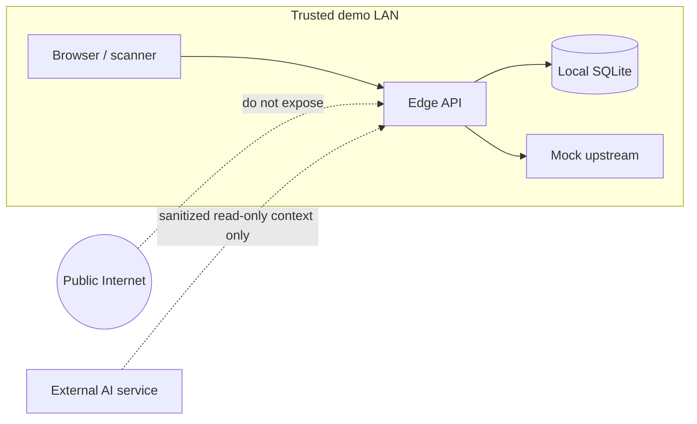

# TraceGate Edge Architecture

TraceGate Edge is a **local-first, offline-capable manufacturing traceability reference implementation that uses entirely synthetic data**. It demonstrates how an edge station can enforce deterministic process rules and retain auditable records during unreliable connectivity, then deliver events safely after the connection recovers.

> This is an independently developed educational and portfolio project. It is not a production MES and does not represent any company's, factory's, or customer's system. All names, part numbers, serial numbers, MAC addresses, routes, and data are fictional.

## Design goals

- **Local decision-making:** The station can continue enforcing previously downloaded rules during a temporary upstream outage.
- **Fail closed:** Reject station completion when data is incomplete, route order is incorrect, identity does not match, or requirements are unsatisfied.
- **Complete traceability:** Input attempts, validations, station events, repairs, and delivery states remain independently inspectable.
- **Retry without repeating business actions:** The API and upstream receiver use idempotency keys to prevent duplicate operations.
- **Runnable on a small edge computer:** The runtime uses only the Python standard library and SQLite.
- **AI does not control the quality gate:** AI may summarize or explain existing results, but it cannot authorize `PASS`, rewrite WIP, or bypass rules.

## System overview

## Deployment topology

A credible demonstration treats the station and upstream system as separate failure domains. During development, two processes can run on the same computer. For a portfolio demonstration, Edge can run on an edge board while Mock Upstream runs on a laptop, proving that outage and recovery are not merely a switch inside one process.

## Component responsibilities

| Component | Responsibility | Explicitly does not |
| --- | --- | --- |
| Web UI | Collect scans and display current route position, reason codes, and trace data | Decide PASS on its own |
| HTTP API | Validate JSON, return consistent errors, and accept request IDs | Bypass the domain service |
| Domain service | Enforce ACN, MAC, key-part, route, repair, and idempotency rules | Depend on UI state |
| SQLite | Provide transactions, WIP, events, local audit sequence, outbox, and receipts | Act as an enterprise central database or cross-node ordering service |
| Outbox worker | Lease pending events, retry with backoff, and mark delivery or dead-letter | Treat a network timeout as business success |
| Mock receiver | Simulate upstream receipt and idempotent responses | Impersonate a real MES |
| AI explainer (not enabled) | Convert existing events and reason codes into human-readable summaries | **Authorize PASS, change route order, or write WIP** |

## Write path and transaction boundary

The critical writes for one station-completion request must occur within one SQLite `BEGIN IMMEDIATE` transaction:

1. Check whether `request_id` has already been processed.
2. Lock and read current WIP.
3. Validate the product, work order, route/version, station order, and prerequisite evidence.
4. Write the domain record, such as `station_events`, and allocate a local `audit_sequence` in `audit_log`.
5. Update `wip_state`, or preserve it while recording a failed result.
6. Insert a `delivery_outbox` row.
7. Store the idempotent response for the same request.
8. Commit once; if any step fails, roll back all steps.

This boundary prevents half-complete states such as "WIP advanced but no event was retained" or "an event was retained but can never be delivered." Schema migration v2 allocates `audit_log.audit_sequence` in the same domain transaction, giving different record types a reproducible causal order within one SQLite database.

## Read model

- `GET /api/v1/units/{acn}`: Current work order, route, WIP, route position, and bound identity summary.
- `GET /api/v1/units/{acn}/trace`: Station events, validations, key parts, and repairs ordered by local `audit_sequence`; timestamps are for display and legacy fallback only.
- `GET /api/v1/health`: Process and database serviceability.
- `GET /api/v1/metrics`: Synthetic product, WIP, event, defect, and delivery counts.
- `GET /api/v1/outbox`: Pending, retrying, dead-letter, and delivered rows.

The mock receiver exposes its own health state at `GET /api/v1/health`. Current API tests define the authoritative endpoints. If these names change before integration, update the README, demo guide, and tests together.

## Trust boundary

The current version has no enterprise authentication, TLS termination, key rotation, or multi-tenant isolation. Demonstrate it only on a trusted personal development network; do not expose it directly to the public internet.

## Core invariants

1. An ACN has only one current WIP state at a time.
2. A `request_id` maps to one normalized payload; reuse with a different payload must be rejected.
3. An out-of-route operation cannot advance WIP.
4. A syntactically valid MAC does not prove a valid association; both ACN and interface must match.
5. A key part must belong to the work order and a group allowed at the station, and its KPSN cannot be bound twice.
6. A test FAIL enters the repair branch. A valid repair completion creates a new attempt before returning to retest.
7. The business transaction for a `PASS` and its outbox record must be persisted together.
8. An upstream timeout means unknown/pending retry, not successful delivery.
9. AI output is never a basis for process authorization.
10. `audit_sequence` represents commit-level causal order only within one SQLite database or edge device; it is not global time or global order across devices.

## Tradeoffs

- SQLite suits a single station, low deployment overhead, and a portable demonstration. It is not presented as the final data layer for a highly concurrent multi-station system.
- The standard-library HTTP server reduces dependencies on the edge board, but lacks the middleware and schema ecosystem of a mature framework.
- A single-node durable outbox handles temporary outages. Storage-device failure still requires a backup or replication strategy.
- Retry plus an idempotent receiver produces an effectively-once result. A distributed network cannot honestly promise true exactly-once delivery.

Related documentation:

- [Domain model](domain-model.md)
- [Reliability semantics](reliability-semantics.md)
- [Learning concepts to architecture decisions](learning-to-architecture.md)
- [Demo guide](demo-guide.md)
- [Security and publication checklist](security-publication-checklist.md)
