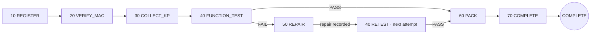
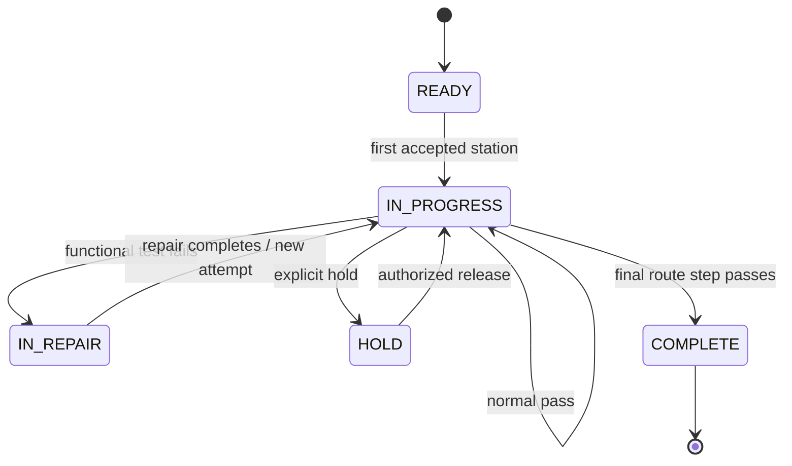
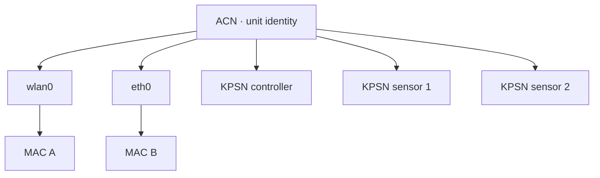

# Domain Model and State Machine

This document defines TraceGate Edge's synthetic manufacturing domain. The table names are part of a public model designed specifically for this portfolio project; they do not correspond to any real company's schema.

## Terminology

| Term | Meaning in This Project |
| --- | --- |
| ACN | The unique primary identity of a synthetic product unit |
| Work order | A production batch that specifies a product model, route version, and quantity |
| Route | The ordered sequence of process steps a product must complete; fixed by version |
| WIP | The ACN's current step, state, and attempt number |
| Interface | A network interface on the product, such as `wlan0` or `eth0` |
| MAC | The communication identity of a specific interface; not the product's primary identity |
| Part number | A component type |
| KPSN | The serial number of the specific key part installed in a product |
| Key-part group | A set of mutually approved substitute parts |
| Station event | The result and evidence associated with one manufacturing operation |
| Audit sequence | A monotonically increasing causal sequence allocated across record types within one edge SQLite database |
| Defect / repair | A defect and corrective action following a FAIL result |
| Outbox | Events committed locally and awaiting delivery to the upstream system |

## Entity Relationships

```mermaid
erDiagram
    ROUTES ||--o{ ROUTE_STEPS : contains
    ROUTES ||--o{ WORK_ORDERS : selected_by
    WORK_ORDERS ||--o{ PRODUCTS : releases
    PRODUCTS ||--|| WIP_STATE : has_current
    PRODUCTS ||--o{ NETWORK_INTERFACES : owns
    WORK_ORDERS ||--o{ BOM_REQUIREMENTS : requires
    KP_GROUPS ||--o{ BOM_REQUIREMENTS : groups
    KP_GROUPS ||--o{ KP_GROUP_MEMBERS : contains
    MATERIALS ||--o{ KP_GROUP_MEMBERS : belongs_to
    PRODUCTS ||--o{ KEY_PART_BINDINGS : contains
    PRODUCTS ||--o{ VERIFICATION_RECORDS : proves
    PRODUCTS ||--o{ STATION_EVENTS : generates
    PRODUCTS ||--o{ AUDIT_LOG : orders_local_records
    STATION_EVENTS ||--|| DELIVERY_OUTBOX : enqueues
    STATION_EVENTS ||--o{ DEFECTS : may_open
    DEFECTS ||--o{ REPAIR_ACTIONS : resolved_by

    ROUTES {
      string route_id PK
      int version PK
      string status
    }
    ROUTE_STEPS {
      string route_id FK
      int route_version FK
      int sequence PK
      string station_code
      string operation_code
      int on_pass_sequence
      int on_fail_sequence
    }
    WORK_ORDERS {
      string work_order_id PK
      string model_code
      string route_id FK
      int route_version FK
      int planned_qty
      string status
    }
    PRODUCTS {
      string acn PK
      string work_order_id FK
      string status
    }
    WIP_STATE {
      string acn PK
      int current_sequence
      string status
      int attempt_no
      int version
    }
    NETWORK_INTERFACES {
      string interface_id PK
      string acn FK
      string interface_name
      string mac_address UK
      string status
    }
    STATION_EVENTS {
      string event_id PK
      string request_id UK
      string acn FK
      int sequence
      int attempt_no
      string result
      string reason_code
      string evidence_json
    }
    DELIVERY_OUTBOX {
      string event_id PK_FK
      string status
      int attempts
      float next_attempt_at
      string last_error
    }
    AUDIT_LOG {
      int audit_sequence PK
      string record_type
      string record_id UK
      string request_id
      string acn
      string occurred_at
    }
```

## Synthetic Demo Data

The default seed creates three entirely fictional products:

- Work order: `WO-DEMO-1001`
- Model: `EDGE-CONTROLLER-A`
- ACNs: `ACN-DEMO-0001` through `ACN-DEMO-0003`
- Route: `ROUTE-DEMO-A`, version `1`
- Interfaces: one `wlan0` and one `eth0` per product
- Part groups: one controller required and two sensors required

MAC addresses use a locally administered prefix beginning with `02`, so they do not resemble real vendor assignments. Every KPSN must be a fictional value created by the presenter, such as `KPSN-DEMO-CTRL-001`.

## Route



### Why Route Versions Matter

A work order references an explicit `route_id + route_version`. Even if the route changes later, the new version must not silently alter the historical meaning of released work orders. Each event also stores its route, version, and sequence, avoiding historical reconstruction based solely on current configuration.

## WIP State



The current implementation may not expose write endpoints for HOLD/RELEASE. The data model retains these states to support future roadmap work, not to imply that the functionality is already complete.

### Attempts, Not Blanket Duplicate Blocking

A retest is a legitimate new manufacturing event. The system therefore cannot block an ACN from ever visiting the same station more than once. The correct model is:

- Same `request_id`: a retransmission of the same HTTP operation; return the existing result.
- New `request_id`, same attempt, and an already completed station: route violation or duplicate operation.
- Repair completed: increment `attempt_no`; running the test again is a new, valid event.

## Identity Model: ACN, MAC, and KPSN Are Distinct



MAC verification must check all of the following:

1. The format is valid.
2. The MAC exists and has an allowed status.
3. The MAC is bound to the ACN in the request.
4. The MAC is bound to the interface in the request.
5. The verification corresponds to the current sequence and attempt.

Therefore, a MAC with valid formatting that belongs to another product must return an association error; it must not PASS.

## BOM and Key Parts

`bom_requirements` specifies which key-part groups and quantities a work order requires at a given step. `kp_group_members` defines primary and approved substitute parts. Keeping these concepts separate prevents the system from treating every known part number as approved for a given work order.

At collection time, the system checks at least the following:

- The ACN and WIP state are correct.
- The part number exists and is active.
- The part number belongs to the required group.
- If the same part number matches multiple required groups, the current API fails closed with `AMBIGUOUS_BOM_GROUP`. To support such BOMs in the future, the command must carry an explicit group identity instead of allowing the database to select one arbitrarily.
- The required quantity has not been exceeded.
- The KPSN is not bound to another product.
- The `request_id` has not been reused with a different payload.

## Separating Events from Current State

- `wip_state` answers the fast current-state question: "Where is the unit now?"
- `station_events` provides the historical answer: "What happened?"
- `scan_attempts` may include rejected inputs for analyzing human-interface and data-quality issues.
- `verification_records` preserves prerequisite verification evidence such as MAC checks.
- `audit_log` maps the historical records above through `record_type + record_id` and assigns an `audit_sequence` to create a local causal order across record types.

Current state without history is not auditable. Replaying the entire event history for every small-station UI request is also impractical. Both representations remain consistent because the system updates them in the same transaction.

Migration v2 creates audit rows for existing records. A legacy backfill can use only existing timestamps, record kinds, and row IDs to establish a stable order; it cannot reconstruct the exact historical commit order. New domain writes after migration allocate their sequence within the original transaction. This sequence is meaningful only within one SQLite database/device. It is neither a global sequence across edge nodes nor a trusted timestamp.

## Defects and Repairs

A functional-test FAIL creates a defect and routes WIP to the repair step. A repair action should include a structured action code, a technician identifier, and a description that contains no sensitive information. After repair completes, the unit begins a new attempt and returns to functional testing.

An AI summary, free-form text, or UI control must never change a FAIL directly to PASS. Manufacturing results can come only from deterministic rules and explicit station commands.

## Recommended Reason Codes

Reason codes are stable machine interfaces. Display text may be translated, but logic must not depend on that text.

| Category | Example Reason Codes |
| --- | --- |
| Request | `INVALID_REQUEST_ID`, `IDEMPOTENCY_CONFLICT` |
| Product | `INVALID_ACN`, `UNKNOWN_ACN`, `UNIT_ON_HOLD` |
| Route | `ROUTE_VIOLATION`, `INVALID_REASON_CODE`, `STATION_MISMATCH`, `DUPLICATE_OPERATION` |
| MAC | `INVALID_MAC_FORMAT`, `UNKNOWN_MAC`, `ASSOCIATION_MISMATCH`, `WRONG_INTERFACE` |
| Key parts | `UNKNOWN_PART`, `MATERIAL_NOT_IN_BOM`, `AMBIGUOUS_BOM_GROUP`, `KPSN_ALREADY_BOUND`, `QUANTITY_EXCEEDED` |
| Repair | `NO_OPEN_DEFECT`, `REPAIR_ACTION_REQUIRED` |
| Delivery | `UPSTREAM_UNAVAILABLE`, `OUTBOX_DEAD_LETTER` |

The actual endpoint response set is defined by the current code and automated tests. When adding a reason code, update the documentation, tests, and demo together.
