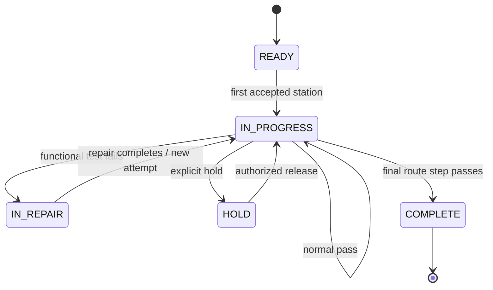
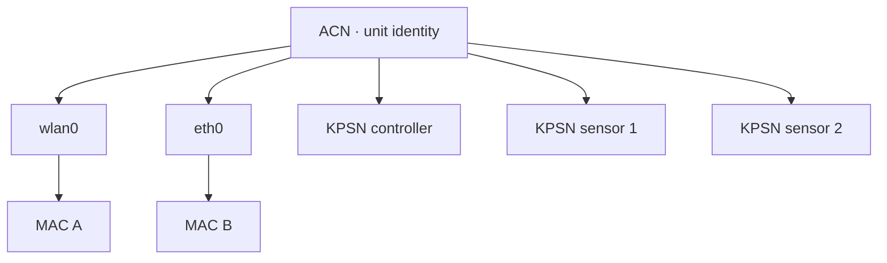

# 領域模型與狀態機

本文件定義 TraceGate Edge 的合成製造領域。資料表名稱是這個作品專案自行設計的公開模型，不對應任何真實公司的 schema。

## 名詞

| 名詞 | 在本專案中的意思 |
| --- | --- |
| ACN | 一台合成產品的唯一主身份（unit identity） |
| Work order | 指定產品型號、route 版本與數量的生產批次 |
| Route | 產品必須依序通過的製程步驟；以版本固定 |
| WIP | 該 ACN 現在位於哪一步、狀態與第幾次 attempt |
| Interface | 產品上的網路介面，例如 `wlan0` 或 `eth0` |
| MAC | 某個 interface 的通訊身份；不是產品本身的主身份 |
| Part number | 料件種類 |
| KPSN | 實際裝入的那一顆關鍵料序號 |
| Key-part group | 可互為核准替代料的料件集合 |
| Station event | 一次製程操作的結果與證據 |
| Audit sequence | 單一 edge SQLite database 內，跨 record type 配發的遞增因果序號 |
| Defect / repair | FAIL 後的缺陷與修復處置 |
| Outbox | 已在本地 commit、尚待送往上游的事件 |

## 關聯圖

```mermaid
erDiagram
    ROUTES ||--o{ ROUTE_STEPS : contains
    ROUTES ||--o{ WORK_ORDERS : selected_by
    WORK_ORDERS ||--o{ PRODUCTS : releases
    PRODUCTS ||--|| WIP_STATE : has_current
    PRODUCTS ||--o{ NETWORK_INTERFACES : owns
    WORK_ORDERS ||--o{ BOM_REQUIREMENTS : requires
    KP_GROUPS ||--o{ BOM_REQUIREMENTS : groups
    KP_GROUPS ||--o{ KP_GROUP_MEMBERS : contains
    MATERIALS ||--o{ KP_GROUP_MEMBERS : belongs_to
    PRODUCTS ||--o{ KEY_PART_BINDINGS : contains
    PRODUCTS ||--o{ VERIFICATION_RECORDS : proves
    PRODUCTS ||--o{ STATION_EVENTS : generates
    PRODUCTS ||--o{ AUDIT_LOG : orders_local_records
    STATION_EVENTS ||--|| DELIVERY_OUTBOX : enqueues
    STATION_EVENTS ||--o{ DEFECTS : may_open
    DEFECTS ||--o{ REPAIR_ACTIONS : resolved_by

    ROUTES {
      string route_id PK
      int version PK
      string status
    }
    ROUTE_STEPS {
      string route_id FK
      int route_version FK
      int sequence PK
      string station_code
      string operation_code
      int on_pass_sequence
      int on_fail_sequence
    }
    WORK_ORDERS {
      string work_order_id PK
      string model_code
      string route_id FK
      int route_version FK
      int planned_qty
      string status
    }
    PRODUCTS {
      string acn PK
      string work_order_id FK
      string status
    }
    WIP_STATE {
      string acn PK
      int current_sequence
      string status
      int attempt_no
      int version
    }
    NETWORK_INTERFACES {
      string interface_id PK
      string acn FK
      string interface_name
      string mac_address UK
      string status
    }
    STATION_EVENTS {
      string event_id PK
      string request_id UK
      string acn FK
      int sequence
      int attempt_no
      string result
      string reason_code
      string evidence_json
    }
    DELIVERY_OUTBOX {
      string event_id PK_FK
      string status
      int attempts
      float next_attempt_at
      string last_error
    }
    AUDIT_LOG {
      int audit_sequence PK
      string record_type
      string record_id UK
      string request_id
      string acn
      string occurred_at
    }
```

## 合成示範資料

預設 seed 建立三台完全虛構的產品：

- Work order：`WO-DEMO-1001`
- Model：`EDGE-CONTROLLER-A`
- ACN：`ACN-DEMO-0001` 至 `ACN-DEMO-0003`
- Route：`ROUTE-DEMO-A` version `1`
- Interface：每台各有 `wlan0` 與 `eth0`
- 料件群組：controller 需要 1 顆，sensor 需要 2 顆

MAC 使用 `02` 起頭的 locally administered 位元，避免看起來像真實廠商分配。所有 KPSN 必須由展示者建立虛構值，例如 `KPSN-DEMO-CTRL-001`。

## Route


### Route 版本的重要性

Work order 參照明確的 `route_id + route_version`。即使日後修改路線，新版也不能悄悄改變已釋放工單的歷史語意。事件本身也保存 route/version/sequence，避免只靠目前設定回推歷史。

## WIP 狀態



目前實作未必開放 HOLD/RELEASE 寫入端點；資料模型保留狀態，是為了讓 roadmap 可擴充，而不是假稱功能已完成。

### Attempt 而非「重複阻擋」

重測是合法的新製造事件，因此不能用「同一 ACN + 同一站永遠只能一次」阻擋。正確模型是：

- 相同 `request_id`：同一次 HTTP 操作的重送，回傳既有結果。
- 新 `request_id`、相同 attempt 與已完成站點：route violation 或 duplicate operation。
- 修復完成：`attempt_no + 1`，再次執行測試是新的合法事件。

## 身份模型：ACN、MAC、KPSN 不可混為一談



MAC 驗證必須同時檢查：

1. 格式有效。
2. MAC 存在且狀態允許。
3. MAC 綁定到請求中的 ACN。
4. MAC 綁定到請求中的 interface。
5. 驗證對應目前 sequence 與 attempt。

因此「格式正確但屬於另一台產品」必須回傳關聯錯誤，不能 PASS。

## BOM 與關鍵料

`bom_requirements` 指定某 work order 在某 step 需要哪些 key-part group 及數量。`kp_group_members` 定義正料與核准替代料；兩者分開，才不會把「系統知道的料號」誤當成「本工單允許的料號」。

收料時至少檢查：

- ACN 與 WIP 正確。
- Part number 存在且啟用。
- Part number 屬於該 requirement group。
- 若同一 part number 同時命中多個 required groups，現行 API 會以 `AMBIGUOUS_BOM_GROUP` fail closed；未來若要支援此類 BOM，command 必須明確帶入 group identity，不能由資料庫任意挑選。
- 尚未超過需求數量。
- KPSN 未綁定到其他產品。
- `request_id` 沒有被不同 payload 重用。

## 事件與目前狀態分離

- `wip_state` 是快速回答「現在在哪裡」的 current state。
- `station_events` 是「曾發生什麼」的 history。
- `scan_attempts` 可包含被拒絕的輸入，用來分析人機與資料品質問題。
- `verification_records` 保存 MAC 等前置驗證證據。
- `audit_log` 以 `record_type + record_id` 對應上述歷史資料，並用 `audit_sequence` 給跨類型紀錄一個 local causal order。

只有 current state 而沒有 history，無法稽核；只有 history 而每次重播全部事件，對小型站點 UI 又不實際。兩者在同一交易中保持一致。

Migration v2 會為既有紀錄補建 audit rows；legacy backfill 只能用既有 timestamp、record kind 與 rowid 建立穩定順序，不能反推過去精確的 commit order。Migration 後的新 domain writes 則在原交易中配發 sequence。這個 sequence 僅在同一 SQLite database／device 內有意義，不是跨 edge nodes 的 global sequence，也不是可信時間戳。

## Defect 與 repair

功能測試 FAIL 會建立 defect 並將 WIP 導到 repair step。Repair action 應包含結構化 action code、技術人員代號與不含敏感資訊的說明。完成後進入新的 attempt，再回到功能測試。

不得用 AI 摘要、自由文字或 UI 按鈕直接把 FAIL 改成 PASS。製程結果只能來自 deterministic rule 與明確 station command。

## 建議原因碼

原因碼是穩定的機器介面；顯示文字可翻譯，邏輯不應依賴文字。

| 類別 | 原因碼例 |
| --- | --- |
| 請求 | `INVALID_REQUEST_ID`, `IDEMPOTENCY_CONFLICT` |
| 產品 | `INVALID_ACN`, `UNKNOWN_ACN`, `UNIT_ON_HOLD` |
| 站序 | `ROUTE_VIOLATION`, `INVALID_REASON_CODE`, `STATION_MISMATCH`, `DUPLICATE_OPERATION` |
| MAC | `INVALID_MAC_FORMAT`, `UNKNOWN_MAC`, `ASSOCIATION_MISMATCH`, `WRONG_INTERFACE` |
| 關鍵料 | `UNKNOWN_PART`, `MATERIAL_NOT_IN_BOM`, `AMBIGUOUS_BOM_GROUP`, `KPSN_ALREADY_BOUND`, `QUANTITY_EXCEEDED` |
| 維修 | `NO_OPEN_DEFECT`, `REPAIR_ACTION_REQUIRED` |
| 傳輸 | `UPSTREAM_UNAVAILABLE`, `OUTBOX_DEAD_LETTER` |

端點實際回傳集合以自動化測試與目前程式碼為準。新增原因碼時，要同步文件、測試及 demo。
