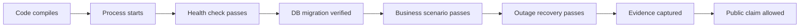

# 從製造系統概念到可執行架構

這份文件說明：常見的 MES 學習主題如何轉成 TraceGate Edge 的公開、合成、可驗證設計。它刻意不複製任何雇主、客戶或課程內部的程式、表格、畫面與命名。

## Clean-room 原則

本專案採「概念重建」而不是「內部系統仿製」：

1. 只保留通用製造問題，例如 route enforcement、traceability、offline delivery。
2. 從零設計名稱、資料模型、API、UI 與程式。
3. 使用虛構工單、料號、序號、站點、IP 與身份。
4. 不放入內部 source、SQL、DLL、設定、截圖、URL 或錯誤訊息。
5. 每一項公開 claim 都要能由這個 repository 自身的測試或 demo 證明。

## 概念對應表

| 學習概念 | 問題本質 | TraceGate 的設計 | 可驗證證據 |
| --- | --- | --- | --- |
| 模組化 MES | 規劃、物料、執行、品質、報表是不同責任 | 先做狹窄的 station execution + traceability bounded context | 架構圖、API 與 schema 的責任邊界 |
| Work order | 產品不是孤立序號，必須屬於被釋放的生產需求 | `work_orders` 綁 model 與固定 route version | Seed、unit lookup、未知/未釋放工單測試 |
| Route / station | 實體設備與邏輯站點不同；產品不能跳站 | `route_steps` + `wip_state.current_sequence` | route violation 測試與 demo |
| WIP / WIP log | 「現在在哪」與「曾經發生什麼」不同 | current state 與 event history 分表，同交易更新 | unit endpoint + trace endpoint |
| Product identity | 主產品身份、通訊身份、零件身份不可混用 | ACN、interface/MAC、KPSN 三層模型 | 正確 MAC / 錯產品 MAC / 錯 interface 測試 |
| BOM / approved substitute | 系統知道的料號不代表本工單可用 | requirement group + approved member + quantity | 未列料、核准替代料、超量、重複 KPSN 測試 |
| Key-part trace | 要回答實際裝了哪一顆，而不只是料號種類 | `key_part_bindings` 保存 parent、KPSN、part、step、attempt | ACN trace timeline |
| Test / NG / repair | FAIL 不能被新一次 PASS 靜默覆蓋 | defect → repair action → new attempt → retest | fail/repair/retest 狀態機測試 |
| 品質放行 | 顯示成功與業務放行是不同層次 | stable reason codes + deterministic domain rules | fail-closed 測試；AI 只讀 policy |
| 整合介面 | 檔案/HTTP 存在不代表業務已成功 | local commit 與 upstream acknowledgement 分開 | outbox/receipt 狀態與 outage demo |
| 排程與背景工作 | 背景程序可能重跑、逾時或在中間停止 | lease、backoff、dead-letter、idempotent receiver | retry/dead-letter/duplicate 與 component re-instantiation tests；OS process-restart test pending |
| Build/runtime/config | Build 成功不代表正確 artifact 正在跑 | `/health`、版本資訊、資料庫 migration 及啟動 log | smoke test 與版本輸出 |
| DB transaction | 多筆寫入中途失敗會造成半完成狀態 | `BEGIN IMMEDIATE` 包住 event/WIP/outbox/idempotency | SQLite trigger fault-injection rollback test |
| 多語 UI / error handling | 顯示文字會變，程式不能靠文字做邏輯 | 穩定 `reason_code` 與可替換 message | API contract tests |
| Debugging | 需要分清 UI、API、domain、DB、network 哪層失敗 | 分層模組 + correlation IDs + structured result | traceable request/event IDs |
| 報表與 KPI | 沒有可靠事件粒度，KPI 只是漂亮數字 | 先定義 event grain，再衍生 metrics | 可重算的合成資料與 metric definitions |

## 為什麼不是把所有 MES 模組都做出來

成熟的作品集不是功能名單最長，而是範圍清楚、資料一致、錯誤可重現。TraceGate 選擇一個可完整閉環的 slice：

```text
工單與路線
  → 產品進站
  → 身份驗證
  → 關鍵料綁定
  → 測試 / 失敗 / 維修 / 重測
  → 包裝與完成
  → 離線事件可靠補送
```

採購、倉儲、財務、完整排程與企業主資料屬於外部 bounded contexts。作品中可以定義 adapter contract，但不應假裝已實作整套 ERP 或 MES。

## 由除錯經驗萃取的五個設計規則

### 1. 不讓後面的成功蓋掉前面的失敗

多步驗證必須 fail fast，或聚合明確的錯誤集合。不能先得到 `False`，後續又把共用布林值設回 `True`。Domain service 使用 typed error / reason code，任何未通過的 precondition 都不更新 WIP。

### 2. 回傳值必須代表實際結果

資料庫寫入失敗不能仍回 success。API 成功只在 transaction commit 後產生；upstream delivery 則使用另一個欄位，不偷換概念。

### 3. 每筆操作都要有自己的狀態

不得讓上一次 ACN 的暫存資料污染下一次掃描。Command 是 immutable request；工作資料從 DB 依 request 讀取，不使用跨請求的全域 mutable table。

### 4. 欄位驗證要針對正確欄位

格式、存在性、關聯與數量是不同規則。MAC 格式通過後還要驗證 ACN/interface；KPSN 合法後還要驗證 part group 與唯一性。

### 5. 秘密不進 source

憑證、真實 endpoint、token 或共享帳密不能 hard-code。作品版也不放假裝像真的秘密；使用 `.env.example`、環境變數與明確的 demo-only default。

## 從「能跑」到「能證明」



每一層都不能推論下一層。Component re-instantiation、OS process restart、power loss 與 rollback fault injection 是彼此不同的證據；目前已測前者與 rollback injection，但不能據此推論 kill/reboot 或斷電一定安全。README 只能描述 repository 已有且測過的功能；roadmap 則使用未完成語氣。

## 硬體的合理角色

同一套程式可先在筆電完成，因為真正的難題是規則、交易、狀態與失敗恢復。邊緣板帶來的作品價值是：

- 展示程式可在獨立、資源有限的 Linux 節點運行。
- 與上游分成不同故障域，能做可信的斷線測試。
- 之後可接 HID scanner、隔離 I/O 或現場協定 adapter。
- 支援 power-cycle、持久儲存與 headless operation 的實測。

它不是為了把原本能在筆電跑的 Python 變得神祕。先以軟體證明需求，再依量測瓶頸決定是否需要 MCU、FPGA 或客製晶片。

## AI Agent 的安全位置

AI 可讀取已去識別的：

- reason code 與安全 message
- event timeline
- outbox/dead-letter 狀態
- runbook 與公開文件

AI 可以回答「為什麼被擋下」或「下一個安全檢查是什麼」，但不能：

- 呼叫 station PASS endpoint。
- 修改 route、BOM、WIP 或 repair disposition。
- 產生或核准 MAC/序號綁定。
- 以自然語言覆蓋 deterministic rule。

若日後加入 agent，工具層應只開 read-only API；任何操作建議都由人類透過正常 UI 與權限流程執行。
