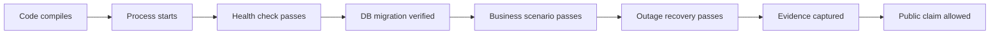

# From Manufacturing-System Concepts to an Executable Architecture

This document explains how common MES learning topics translate into TraceGate Edge's public, synthetic, and verifiable design. It deliberately does not copy any employer, customer, or course's internal code, tables, screens, or naming.

## Clean-Room Principles

This project reconstructs concepts instead of imitating an internal system:

1. Retain only general manufacturing problems, such as route enforcement, traceability, and offline delivery.
2. Design the names, data model, APIs, UI, and code from scratch.
3. Use fictional work orders, part numbers, serial numbers, stations, IP addresses, and identities.
4. Do not include internal source code, SQL, DLLs, configuration, screenshots, URLs, or error messages.
5. Every public claim must be supported by tests or a demo contained in this repository.

## Concept Mapping

| Learning Concept | Underlying Problem | TraceGate Design | Verifiable Evidence |
| --- | --- | --- | --- |
| Modular MES | Planning, material, execution, quality, and reporting are separate responsibilities | Implement a narrow station-execution and traceability bounded context first | Responsibility boundaries in the architecture diagram, API, and schema |
| Work order | A product is not an isolated serial number; it must belong to a released production requirement | `work_orders` binds a model to a fixed route version | Seed data, unit lookup, and tests for unknown or unreleased work orders |
| Route / station | Physical equipment and logical stations are different; a product cannot skip process steps | `route_steps` + `wip_state.current_sequence` | Route-violation tests and demo |
| WIP / WIP log | "Where is it now?" and "What happened?" are different questions | Store current state and event history separately, and update them in one transaction | Unit endpoint + trace endpoint |
| Product identity | Primary product, communication, and component identities must not be conflated | Three-level ACN, interface/MAC, and KPSN model | Tests for the correct MAC, another product's MAC, and the wrong interface |
| BOM / approved substitute | A part known to the system is not necessarily allowed for this work order | Requirement group + approved member + quantity | Tests for an unlisted part, approved substitute, over-quantity collection, and duplicate KPSN |
| Key-part traceability | The system must identify the exact installed component, not merely its part-number type | `key_part_bindings` stores parent, KPSN, part, step, and attempt | ACN trace timeline |
| Test / NG / repair | A later PASS must not silently overwrite a FAIL | Defect → repair action → new attempt → retest | Fail/repair/retest state-machine tests |
| Quality disposition | Displaying success and authorizing production disposition are different concerns | Stable reason codes + deterministic domain rules | Fail-closed tests; read-only AI policy |
| Integration boundary | The existence of a file or HTTP request does not prove business-level success | Separate local commit from upstream acknowledgement | Outbox/receipt states and outage demo |
| Scheduling and background work | A background process may rerun, time out, or stop mid-operation | Leases, backoff, dead-letter handling, and an idempotent receiver | Retry, dead-letter, duplicate, and component re-instantiation tests; OS process-restart test pending |
| Build/runtime/configuration | A successful build does not prove that the correct artifact is running | `/health`, version information, database migrations, and startup logs | Smoke test and version output |
| Database transaction | Failure during a multi-row write can leave partially completed state | `BEGIN IMMEDIATE` wraps event/WIP/outbox/idempotency writes | SQLite trigger fault-injection rollback test |
| Multilingual UI / error handling | Display text changes; program logic must not depend on it | Stable `reason_code` values and replaceable messages | API contract tests |
| Debugging | Failures must be localized to the UI, API, domain, database, or network layer | Layered modules + correlation IDs + structured results | Traceable request and event IDs |
| Reports and KPIs | Without a reliable event grain, KPIs are only attractive numbers | Define event grain first, then derive metrics | Recomputable synthetic data and metric definitions |

## Why This Project Does Not Implement Every MES Module

A mature portfolio project is defined by clear scope, consistent data, and reproducible failures—not by the longest feature list. TraceGate selects one end-to-end slice that can close the loop completely:

```text
Work order and route
  → Product enters station
  → Identity verification
  → Key-part binding
  → Test / failure / repair / retest
  → Pack and complete
  → Reliable offline event forwarding
```

Procurement, warehousing, finance, full scheduling, and enterprise master data are external bounded contexts. The portfolio may define adapter contracts for them, but it should not imply that a complete ERP or MES has been implemented.

## Five Design Rules Derived from Debugging Experience

### 1. Never Let a Later Success Overwrite an Earlier Failure

Multi-step validation must fail fast or aggregate an explicit error set. The system must not first obtain `False` and then allow a later step to set a shared Boolean back to `True`. The domain service uses typed errors and reason codes, and no failed precondition may update WIP.

### 2. Return Values Must Represent Actual Outcomes

A database write failure must never return success. API success is generated only after the transaction commits. Upstream delivery uses a separate field so that the system does not conflate local persistence with remote acknowledgement.

### 3. Every Operation Needs Its Own State

Temporary data from a previous ACN must not contaminate the next scan. A command is an immutable request. Working data is loaded from the database for each request, not kept in a global mutable table across requests.

### 4. Validate Each Field Against the Correct Rule

Format, existence, association, and quantity are distinct rules. After a MAC passes format validation, the system must still verify its ACN and interface. After a KPSN is valid, the system must still verify its part group and uniqueness.

### 5. Secrets Do Not Belong in Source Code

Credentials, real endpoints, tokens, and shared passwords must never be hard-coded. Even a portfolio build should not contain realistic-looking fake secrets. Use `.env.example`, environment variables, and explicit demo-only defaults.

## From "It Runs" to "It Is Proven"



No layer proves the next one automatically. Component re-instantiation, OS process restart, power loss, and rollback fault injection are different forms of evidence. The current project has tested component re-instantiation and rollback injection, but those results do not prove that kill/reboot or power loss is safe. The README should describe only repository behavior that has been implemented and tested; roadmap items must use future-tense language.

## The Appropriate Role of Hardware

The same software can be completed first on a laptop because the hard problems are rules, transactions, state, and failure recovery. An edge board adds portfolio value by enabling the project to:

- Demonstrate that the software runs on an independent, resource-constrained Linux node.
- Separate the edge node from the upstream service into different failure domains, enabling credible outage tests.
- Connect HID scanners, isolated I/O, or field-protocol adapters later.
- Measure power-cycle recovery, persistent storage, and headless operation.

The board is not intended to make Python that already runs on a laptop seem mysterious. Prove the software requirement first, and then use measured bottlenecks to determine whether an MCU, FPGA, or custom chip is warranted.

## The Safe Role of an AI Agent

AI may read de-identified versions of:

- Reason codes and safe messages
- Event timelines
- Outbox and dead-letter status
- Runbooks and public documentation

AI may answer "Why was this blocked?" or "What is the next safe check?" It must not:

- Call a station PASS endpoint.
- Modify a route, BOM, WIP state, or repair disposition.
- Generate or approve a MAC or serial-number binding.
- Override a deterministic rule through natural language.

If an agent is added later, its tool layer should expose read-only APIs only. A human must execute any recommended action through the normal UI and authorization workflow.
