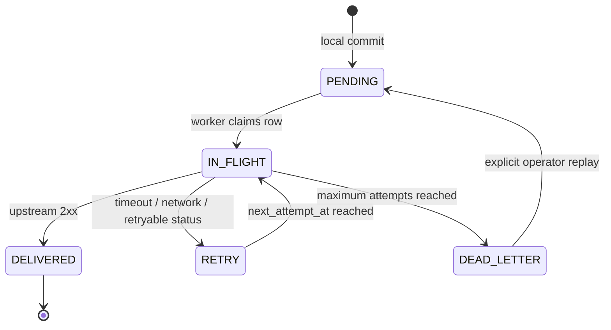

# 離線、Outbox 與冪等語意

TraceGate Edge 不把「收到 HTTP 請求」、「本地業務成功」與「上游已收到」混成同一件事。這三個里程碑必須分別有證據。

## 三個成功層級

| 層級 | 可回答的問題 | 證據 |
| --- | --- | --- |
| Request accepted | API 是否理解並接受這份命令？ | HTTP status、reason code、request ID |
| Local committed | 本地 WIP、event 與 outbox 是否一起落盤？ | SQLite transaction commit、event ID |
| Upstream acknowledged | 上游是否以相同 idempotency key 接收？ | receipt / `DELIVERED` 時間 |

本地成功但上游離線時，API 可回傳業務成功，同時顯示 delivery 是 `PENDING` 或 `RETRY`。它不應說「已同步」。

## Transactional Outbox



狀態機的目的不是畫面好看，而是避免這個故障窗口：先更新 WIP，再嘗試發送 HTTP；如果程序在中間停止，上游永遠不知道該事件。Transactional outbox 把 `station_events`、`wip_state` 與 `delivery_outbox` 放在同一次本地交易中，worker 之後才負責網路 I/O。

## Delivery contract

建議上游事件傳送契約：

```http
POST /api/v1/trace-events HTTP/1.1
Content-Type: application/json
Idempotency-Key: evt_<stable-event-id>
```

上游以 event ID 或 `Idempotency-Key` 建立唯一限制：

- 第一次收到：持久化並回 `2xx`。
- 同一 key、相同 payload：回傳既有 receipt，仍可是 `2xx`。
- 同一 key、不同 payload：回 `409 Conflict`。

Edge 只有在明確的成功回覆後才標記 `DELIVERED`。連線中斷或逾時可能發生在上游已 commit、回覆尚未抵達之後，因此 Edge 必須安全重送，而上游必須冪等。

## Effectively-once，不是 exactly-once

跨網路沒有免費的 exactly-once。這個專案提供的是：

1. 本地 state/event/outbox 原子 commit。
2. at-least-once 傳送。
3. 接收端以唯一 key 去重。

三者合起來形成可觀察的 effectively-once 業務效果。GitHub 或 LinkedIn 不應宣稱「保證 distributed exactly-once」。

## API 冪等

每個改變狀態的命令都應包含 client-generated `request_id`。伺服器儲存：

- operation name
- canonical payload hash
- HTTP status
- complete response JSON

再次收到請求時：

| 條件 | 行為 |
| --- | --- |
| ID 不存在 | 執行一次，儲存結果 |
| ID 存在且 operation/payload 相同 | 不重做，回傳已儲存結果並標示 replay |
| ID 存在但 payload 不同 | `409 IDEMPOTENCY_CONFLICT` |

Canonical hash 必須排除 JSON key 排列差異，並保留實際業務值。不能只用 `ACN + station` 當冪等鍵，否則合法的 rework/retest 也會被永久封鎖。

## Retry policy

重試需要退避，避免上游復原時被大量請求再次壓垮。參考策略：

```text
delay = min(base * 2^(attempts - 1), maximum) + bounded_jitter
```

實作與測試應確認：

- `attempts` 每次實際送出後才增加。
- `next_attempt_at` 使用單調可比較時間或一致 UTC 規則。
- Claim 使用依 batch 大小與 HTTP timeout 拉長的 `IN_FLIGHT + locked_until` lease；完成/失敗更新另以原 lease 值做 CAS fencing，過期 worker 不能覆寫新 owner 的狀態。
- Lease 不是 distributed lock，也不能保證永遠只有一次 network send：若 worker 暫停、HTTP 超過 lease 或在 acknowledgement window 中止，另一 worker 仍可能重送。因此 delivery 明確採 at-least-once，接收端必須以 event ID 冪等去重。
- 程序在傳送途中中止後，租約過期可再次處理。
- 超過上限進入 `DEAD_LETTER`，不能無限安靜重試。
- 人工 replay 是顯式操作，留下稽核紀錄。

## 事件排序

Schema migration v2 新增 `audit_log.audit_sequence`。新的 station event、verification、key-part binding、defect、repair action 與 rejected scan 都在各自 domain transaction 內配發遞增 sequence，因此即使多筆紀錄具有相同毫秒 timestamp，unit timeline 仍能保留單一 SQLite database 內的跨類型因果順序。自動化測試涵蓋相同 timestamp 下的 event → verification → event 順序。

Outbox claim 依 station event 的 `audit_sequence` 排序；只有缺少 audit row 的 legacy 資料才退回 SQLite rowid。這能決定本機待送事件的 claim 順序，但沒有 per-ACN head-of-line guard：前一事件進入 backoff 時，後一事件仍可能先送達。因此 local causal order 不等於 network delivery order。

`audit_sequence` 是單一 SQLite database／device 的 local order，不是 wall-clock timestamp，也不是跨節點 global order。Legacy migration backfill 使用既有 timestamp、record kind 與 rowid 產生穩定但推定的順序；它無法重建歷史上已遺失的真實 commit chronology。若多個 edge nodes 需要合併順序，必須另外設計 device identity、per-device sequence、server receipt time／logical clock、衝突規則與相應測試。

## 斷線測試矩陣

下表同時列出設計預期與仍應補做的故障實驗；它不是「目前所有列都已有自動化測試」的聲明。現有 automated coverage 包含 retry、dead-letter、manual replay、receiver deduplication、stale-worker CAS fencing、component re-instantiation durability 與 local rollback fault injection；完整 OS process restart / crash-window 測試仍待加入。

| 場景 | 預期結果 |
| --- | --- |
| 上游在過站前停止 | 本地可 commit；outbox 保持 pending/retry |
| 上游收到後、回覆前斷線 | Edge 重送；上游只產生一筆 receipt |
| Edge 在 local commit 後停止 | 重啟後仍找到 outbox 並補送 |
| Edge 在 HTTP 送出途中停止 | 重啟後可重送；接收端去重 |
| 同一 request 重送 | 不新增 station event，不再次前進 WIP |
| 同一 request ID 改 payload | 409 conflict |
| 超過最大重試次數 | dead letter；健康狀態顯示需處理 |
| dead letter 手動 replay | 回 pending，成功後 delivered；保留嘗試歷史 |

## 展示時可量測的指標

以下只能在實際執行測試後報告，不得先填漂亮數字：

- `local_commit_latency_ms`：本地 API 從收到到 commit。
- `outbox_depth`：各狀態 row 數。
- `oldest_pending_age_seconds`。
- `delivery_attempts_total`。
- `delivery_latency_seconds`：local commit 到 upstream acknowledgement。
- `duplicate_receipts_prevented`。
- `dead_letter_count`。

建議展示實驗為 100–1,000 筆合成事件，但 LinkedIn 上只能寫實際跑過的數量、測試環境與結果。

## 正確的展示證據

一次可信的 offline demo 應留下：

1. 上游停止的時間。
2. Edge 仍接受合法操作、outbox 增加的畫面或 JSON。
3. 若要公開宣稱 restart durability：實際重啟 Edge，證明相同資料庫中的 pending 仍在（目前需手動保存，尚無 automated process-restart test）。
4. 上游恢復後 pending 歸零。
5. 上游 receipt count 等於 unique event count。
6. 相同 event 被重送時 receipt 不增加。

僅切換前端「offline」標籤不算故障證據；至少要停止接收程序、阻擋連線，或把 URL 指向不可達端點。
