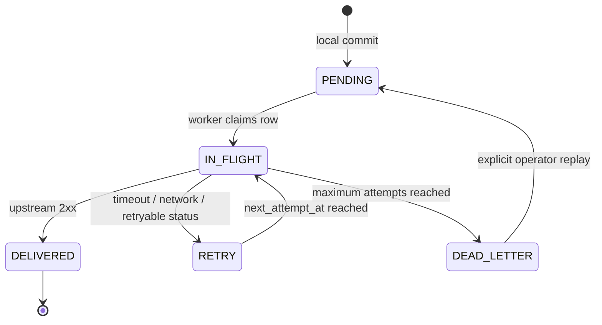

# Offline Operation, the Outbox, and Idempotency Semantics

TraceGate Edge treats "HTTP request received," "local business operation committed," and "upstream system acknowledged" as three distinct events. Each milestone requires its own evidence.

## Three Levels of Success

| Level | Question it answers | Evidence |
| --- | --- | --- |
| Request accepted | Did the API understand and accept the command? | HTTP status, reason code, request ID |
| Local committed | Were the local WIP state, event, and outbox record persisted together? | SQLite transaction commit, event ID |
| Upstream acknowledged | Did the upstream system accept the event under the same idempotency key? | Receipt / `DELIVERED` timestamp |

When the local operation succeeds while the upstream system is offline, the API may report business success while showing a delivery state of `PENDING` or `RETRY`. It must not claim that synchronization is complete.

## Transactional Outbox



This state machine exists to close a specific failure window: if the system updates WIP first and then attempts an HTTP call, a process failure between those actions can leave the upstream system permanently unaware of the event. The transactional outbox writes `station_events`, `wip_state`, and `delivery_outbox` in one local transaction. A worker performs network I/O only after that transaction commits.

## Delivery Contract

Recommended upstream event-delivery contract:

```http
POST /api/v1/trace-events HTTP/1.1
Content-Type: application/json
Idempotency-Key: evt_<stable-event-id>
```

The upstream system enforces uniqueness on the event ID or `Idempotency-Key`:

- First delivery: persist the event and return `2xx`.
- Same key and same payload: return the existing receipt; the response may still be `2xx`.
- Same key and different payload: return `409 Conflict`.

The edge node marks an event `DELIVERED` only after an explicit success response. A connection failure or timeout can occur after the upstream commit but before the response reaches the edge node. The edge node must therefore support safe redelivery, and the upstream system must be idempotent.

## Effectively Once, Not Exactly Once

Exactly-once delivery across a network does not come for free. This project provides:

1. An atomic local commit of state, event, and outbox records.
2. At-least-once delivery.
3. Receiver-side deduplication by unique key.

Together, these properties produce an observable effectively-once business outcome. GitHub or LinkedIn materials must not claim "guaranteed distributed exactly-once delivery."

## API Idempotency

Every state-changing command should include a client-generated `request_id`. The server stores:

- operation name
- canonical payload hash
- HTTP status
- complete response JSON

For subsequent requests:

| Condition | Behavior |
| --- | --- |
| ID does not exist | Execute once and store the result |
| ID exists and the operation/payload match | Do not execute again; return the stored result and mark it as a replay |
| ID exists but the payload differs | Return `409 IDEMPOTENCY_CONFLICT` |

The canonical hash must ignore differences in JSON key ordering while preserving actual business values. Do not use only `ACN + station` as the idempotency key, because doing so would permanently block legitimate rework or retest operations.

## Retry Policy

Retries require backoff so that a recovering upstream service is not immediately overwhelmed. Reference strategy:

```text
delay = min(base * 2^(attempts - 1), maximum) + bounded_jitter
```

Implementation and tests should verify that:

- `attempts` increments only after an actual delivery attempt.
- `next_attempt_at` uses a monotonically comparable clock or a consistent UTC convention.
- Claiming uses an `IN_FLIGHT + locked_until` lease sized for the batch and HTTP timeout. Completion and failure updates use the original lease value as a CAS fence so that an expired worker cannot overwrite the new owner's state.
- A lease is not a distributed lock and cannot guarantee exactly one network send. If a worker pauses, an HTTP call exceeds the lease, or the process stops during the acknowledgment window, another worker may redeliver the event. Delivery is explicitly at least once, so the receiver must deduplicate by event ID.
- If the process stops during delivery, the record becomes eligible for processing again after the lease expires.
- After the maximum number of attempts, the record enters `DEAD_LETTER`; it must not retry silently forever.
- Manual replay is an explicit operation that leaves an audit record.

## Event Ordering

Schema migration v2 adds `audit_log.audit_sequence`. New station events, verifications, key-part bindings, defects, repair actions, and rejected scans receive an increasing sequence within their respective domain transactions. As a result, even when multiple records share the same millisecond timestamp, a unit timeline preserves cross-type causal order within a single SQLite database. Automated tests cover event -> verification -> event ordering under identical timestamps.

Outbox claims are ordered by the station event's `audit_sequence`; only legacy data without an audit row falls back to SQLite row ID. This determines the local claim order for pending events, but there is no per-ACN head-of-line guard: if an earlier event enters backoff, a later event may still arrive first. Local causal order therefore does not imply network delivery order.

`audit_sequence` represents local order within one SQLite database/device. It is neither a wall-clock timestamp nor a global order across nodes. Legacy migration backfill uses existing timestamps, record kind, and row ID to produce a stable but inferred order; it cannot reconstruct historical commit chronology that was never recorded. If multiple edge nodes must merge their histories, the design also needs device identity, a per-device sequence, server receipt time or a logical clock, conflict rules, and corresponding tests.

## Offline Test Matrix

The table below includes both intended behavior and fault experiments that still need to be added. It is not a claim that every row already has automated coverage. Current automated coverage includes retry, dead-letter handling, manual replay, receiver deduplication, stale-worker CAS fencing, component re-instantiation durability, and local rollback fault injection. Full operating-system process restart and crash-window tests remain future work.

| Scenario | Expected result |
| --- | --- |
| Upstream stops before station completion | The local transaction can commit; the outbox remains pending or in retry |
| Connection drops after upstream receipt but before its response | The edge node redelivers; the upstream system produces only one receipt |
| Edge process stops after local commit | The outbox record remains available after restart and is delivered later |
| Edge process stops during the HTTP request | The event can be redelivered after restart; the receiver deduplicates it |
| Same request is submitted again | No new station event is created, and WIP does not advance again |
| Same request ID is reused with a different payload | Return `409 Conflict` |
| Maximum retry count is exceeded | Move the event to dead letter; health status reports that operator action is required |
| Dead letter is replayed manually | Return it to pending, then mark it delivered after success; preserve attempt history |

## Metrics for a Demonstration

These metrics may be reported only after the tests have actually run; do not fill in impressive-looking numbers in advance:

- `local_commit_latency_ms`: local API latency from request receipt to commit.
- `outbox_depth`: number of rows in each state.
- `oldest_pending_age_seconds`.
- `delivery_attempts_total`.
- `delivery_latency_seconds`: time from local commit to upstream acknowledgment.
- `duplicate_receipts_prevented`.
- `dead_letter_count`.

A recommended demonstration uses 100-1,000 synthetic events. LinkedIn materials must report only the number actually executed, the test environment, and the observed results.

## Credible Demonstration Evidence

A credible offline demonstration should preserve:

1. The time when the upstream service stopped.
2. A screenshot or JSON record showing that the edge node continued accepting valid operations while the outbox depth increased.
3. If claiming restart durability publicly: an actual edge restart showing that pending records remain in the same database. This evidence currently requires manual capture because there is no automated process-restart test yet.
4. Evidence that the pending count returns to zero after the upstream service recovers.
5. Evidence that the upstream receipt count equals the unique event count.
6. Evidence that redelivering the same event does not increase the receipt count.

Toggling an "offline" label in the user interface does not count as fault evidence. At minimum, stop the receiver process, block the connection, or point the URL to an unreachable endpoint.
