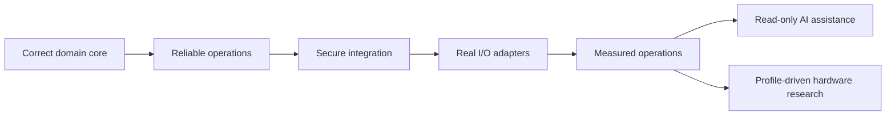

# Roadmap：從作品到可試點的 Edge Station

Roadmap 區分「目前 repository 可證明」與「未來假設」。版本號表示學習與產品化階段，不代表通過任何工業認證。

## 階段 0 — 可執行的合成核心

目標：用一個乾淨、可重現的 vertical slice 證明領域模型。

- 工單、route/version、產品與 WIP。
- ACN / interface / MAC 分層身份驗證。
- BOM group、核准替代料、KPSN 唯一綁定。
- station PASS/FAIL、defect、repair、new attempt 與 retest。
- SQLite migration、transactional outbox、retry/dead-letter。
- 獨立 mock upstream 與冪等 receipt。
- 單元與整合測試、GitHub 文件與 3–5 分鐘 demo。

Release gate：從全新資料目錄執行測試與完整 demo；沒有 secret、真實資料或誇大 claim。

## 階段 1 — 操作可靠性

目標：不只「一次能跑」，而是能安全重啟、觀察與恢復。

- Service manager/autostart 與 graceful shutdown。
- Health/readiness 分離。
- 結構化 JSON log、correlation ID 與 log rotation。
- Outbox per-ACN ordering、租約恢復與人工 replay audit。
- Database backup/restore drill。
- Power-cycle、網路 flap 與 24 小時 soak test。
- Exportable evidence bundle（測試結果、版本、設定摘要、metrics）。

Release gate：重啟與斷線實驗有腳本、時間戳與可重現結果。

## 階段 2 — 安全的整合邊界

目標：讓「可展示」進入「可控試點」之前的最低安全線。

- Reverse proxy + TLS；裝置與上游使用 mTLS。
- Operator / technician / engineer / admin RBAC。
- Device identity、短期 token、密鑰輪替與撤銷。
- Signed release、SBOM、靜態掃描與 vulnerability policy。
- Route/BOM/config 的 signed bundle、版本與 rollback。
- Audit retention、敏感欄位治理與 export control。
- Rate limit、request size、CORS/CSRF 策略與管理端點隔離。

Release gate：有 threat model、權限測試與秘密輪替演練。

## 階段 3 — 真實設備 Adapter（仍用隔離與模擬器先行）

目標：把 domain core 與硬體/協定差異分離。

- USB HID barcode scanner adapter。
- GPIO/relay 只透過光耦或工業隔離 I/O；不把 24V 直接接開發板。
- File-drop adapter：incoming → processing → archive/error，以 checksum 與 atomic rename 保護。
- HTTP/MQTT/OPC UA adapter（依真正需求選擇，不一次全做）。
- Device simulator、contract test 與 hardware-in-the-loop 測試。
- Edge buffer 容量與資料保留策略。

Release gate：拔線、重複訊息、亂序、格式錯誤與設備重啟皆有故障注入測試。

## 階段 4 — 可觀察性與決策支援

目標：從可靠事件衍生透明、可重算的營運訊號。

- P50/P95/P99 local commit 與 delivery latency。
- WIP age、route violation、first-pass yield、repair cycle time。
- Outbox depth、oldest pending、retry/dead-letter alert。
- 每個 KPI 明確定義 grain、分母、時間窗、排除規則與 freshness。
- Dashboard 只讀取事件與聚合，不直接修改 production state。

Release gate：每個公開圖表能追溯到合成事件，無手填漂亮數字。

## 階段 5 — AI 解釋層（read-only）

目標：讓人更快理解失敗，不讓模型成為品質閘門。

- Reason-code explainer：把穩定代碼翻成操作員可懂的步驟。
- Trace summarizer：摘要某 ACN 的 route、零件、測試與 repair timeline。
- Dead-letter triage：依錯誤分類建議 runbook，不能自行 replay。
- Retrieval 僅使用公開 runbook 與已去識別資料。
- 評估 hallucination、unsafe action suggestion、prompt injection 與資料洩漏。

Release gate：agent 工具只有 GET/read，且測試證明無法呼叫 PASS、repair、reset 或 replay。

## 階段 6 — 從 Edge IP 到硬體護城河的研究路線

目標：只有在軟體與設備資料證明瓶頸後，才評估專用硬體。

1. 量測 CPU、memory、I/O、power、latency 與 downtime 的真實瓶頸。
2. 先用 MCU 做 deterministic I/O guardian 或 watchdog。
3. 若存在可並行且穩定的資料路徑，再用 FPGA prototype 驗證。
4. 收集至少一個可量化且重複出現的客戶問題。
5. 只有在量、成本、功耗、供應與 IP 回收期合理時，才研究 ASIC。

可研究的硬體方向包括 secure event timestamping、isolated multi-protocol I/O、deterministic barcode/vision preprocessing 或 tamper-evident device identity。但在 profiling 前買 FPGA/做晶片，不能形成產品證據。

## 優先順序

下一個里程碑的選擇規則：先修復會破壞資料正確性或公開可信度的問題，再增加功能；先取得使用者與測量證據，再增加硬體成本。
