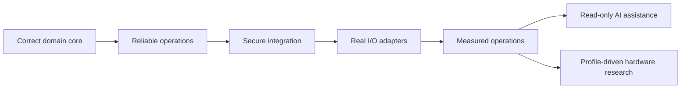

# Roadmap: From Portfolio Project to Pilot-Ready Edge Station

This roadmap distinguishes between what the repository can demonstrate today and what remains a future hypothesis. Version numbers represent learning and productization stages; they do not imply compliance with any industrial certification.

## Stage 0 - Executable Synthetic Core

Goal: demonstrate the domain model with a clean, reproducible vertical slice.

- Work orders, route/version, products, and WIP.
- Layered ACN/interface/MAC identity validation.
- BOM groups, approved substitute parts, and unique KPSN binding.
- Station PASS/FAIL, defects, repair, new attempts, and retest.
- SQLite migrations, transactional outbox, retry, and dead-letter handling.
- Independent mock upstream service and idempotent receipts.
- Unit and integration tests, GitHub documentation, and a three-to-five-minute demonstration.

Release gate: run the tests and complete demonstration from a fresh data directory, with no secrets, real data, or overstated claims.

## Stage 1 - Operational Reliability

Goal: move beyond "it ran once" to safe restart, observation, and recovery.

- Service manager/autostart and graceful shutdown.
- Separate health and readiness signals.
- Structured JSON logs, correlation IDs, and log rotation.
- Per-ACN outbox ordering, lease recovery, and an audit trail for manual replay.
- Database backup and restore drill.
- Power-cycle, network-flap, and 24-hour soak tests.
- Exportable evidence bundle containing test results, version, configuration summary, and metrics.

Release gate: restart and outage experiments have scripts, timestamps, and reproducible results.

## Stage 2 - Secure Integration Boundary

Goal: establish the minimum security baseline required before moving from a demonstration to a controlled pilot.

- Reverse proxy and TLS; mTLS between devices and the upstream service.
- Operator, technician, engineer, and administrator RBAC.
- Device identity, short-lived tokens, key rotation, and revocation.
- Signed releases, an SBOM, static analysis, and a vulnerability policy.
- Signed, versioned route/BOM/configuration bundles with rollback support.
- Audit retention, sensitive-field governance, and export controls.
- Rate limits, request-size limits, CORS/CSRF policy, and administrative endpoint isolation.

Release gate: a threat model, authorization tests, and a secret-rotation drill are complete.

## Stage 3 - Real Device Adapters, Built with Isolation and Simulation First

Goal: separate the domain core from hardware and protocol differences.

- USB HID barcode-scanner adapter.
- GPIO/relay integration only through optocouplers or industrial isolated I/O; never connect 24 V directly to a development board.
- File-drop adapter with incoming -> processing -> archive/error transitions protected by checksums and atomic rename.
- HTTP, MQTT, or OPC UA adapter selected according to actual need rather than implementing all of them at once.
- Device simulator, contract tests, and hardware-in-the-loop tests.
- Edge-buffer capacity and data-retention policy.

Release gate: fault-injection tests cover cable disconnection, duplicate messages, out-of-order delivery, malformed data, and device restart.

## Stage 4 - Observability and Decision Support

Goal: derive transparent, reproducible operational signals from reliable events.

- P50/P95/P99 local commit and delivery latency.
- WIP age, route violations, first-pass yield, and repair cycle time.
- Alerts for outbox depth, oldest pending event, retries, and dead letters.
- Explicit grain, denominator, time window, exclusion rules, and freshness definition for every KPI.
- Dashboards read events and aggregates only; they do not modify production state directly.

Release gate: every public chart is traceable to synthetic events and contains no hand-entered vanity numbers.

## Stage 5 - Read-Only AI Explanation Layer

Goal: help people understand failures more quickly without making the model a quality gate.

- Reason-code explainer that translates stable codes into operator-friendly steps.
- Trace summarizer for the route, parts, tests, and repair timeline of a specific ACN.
- Dead-letter triage that recommends the relevant runbook by error class but cannot perform replay.
- Retrieval limited to public runbooks and de-identified data.
- Evaluation for hallucination, unsafe action recommendations, prompt injection, and data leakage.

Release gate: agent tools expose GET/read operations only, and tests prove that the agent cannot call PASS, repair, reset, or replay operations.

## Stage 6 - Research Path from Edge IP to a Hardware Moat

Goal: evaluate specialized hardware only after software and device data reveal a real bottleneck.

1. Measure actual CPU, memory, I/O, power, latency, and downtime bottlenecks.
2. Start with an MCU as a deterministic I/O guardian or watchdog.
3. If a stable, parallelizable data path exists, validate it with an FPGA prototype.
4. Document at least one quantifiable and recurring customer problem.
5. Investigate an ASIC only when volume, cost, power, supply, and IP payback justify it.

Potential research directions include secure event timestamping, isolated multiprotocol I/O, deterministic barcode or vision preprocessing, and tamper-evident device identity. Buying an FPGA or designing a chip before profiling does not create product evidence.

## Priority Order

Milestone selection rule: fix issues that threaten data correctness or the credibility of public claims before adding features; gather user and measurement evidence before increasing hardware cost.
