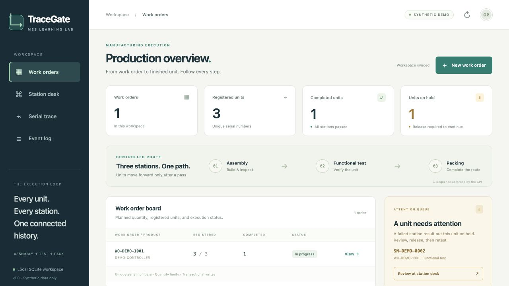
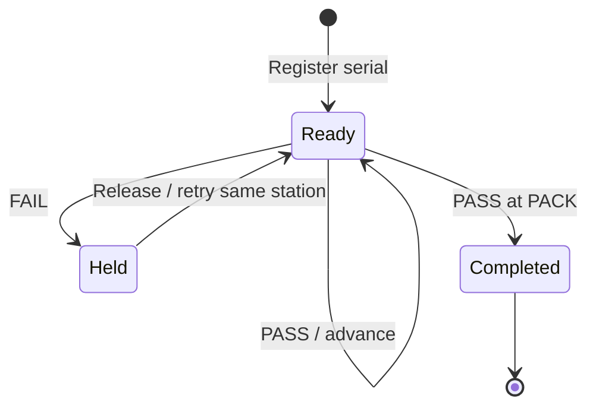

# TraceGate MES Lab

**A focused C# / ASP.NET Core companion lab for work-order and serial-number traceability.**

This application is a focused companion to the flagship TraceGate Edge runtime, with a deliberately smaller scope. It demonstrates dynamic work orders, unit registration, ordered station execution, hold and release, append-only history, request idempotency, CSV export, and a responsive operator UI.

It is **not** a second implementation of TraceGate Edge. Its route, API, and database model are independent, and it does not yet implement edge outbox delivery, MAC validation, BOM genealogy, or repair-attempt semantics.



*Actual running application with synthetic data; not an AI-generated mockup.*

## Run locally

Install the [.NET 10 SDK](https://dotnet.microsoft.com/download/dotnet/10.0), then run:

```sh
dotnet restore src/TraceGate.MesLab
mes_lab_dir="$(mktemp -d)"
MES_DB_PATH="$mes_lab_dir/tracegate-mes-lab.db" \
  dotnet run --project src/TraceGate.MesLab
```

Open <http://localhost:5080>.

The command above keeps the generated SQLite database outside the Git checkout. All seeded orders, products, operators, and serial numbers are synthetic.

If `MES_DB_PATH` is omitted, the application instead creates `src/TraceGate.MesLab/App_Data/tracegate-mes-lab.db`. That path is ignored by Git, but the repository's public-release scanner still rejects generated database files that are present in the working tree.

To use a specific temporary database path:

```sh
MES_DB_PATH=/tmp/tracegate-mes-lab.db dotnet run --project src/TraceGate.MesLab
```

## Verify the lab

Python 3 is used only by the black-box test harness; the application itself is C#.

```sh
dotnet build src/TraceGate.MesLab
python3 -m unittest discover -s tests -v
```

The 22 integration tests launch the compiled ASP.NET Core process against a temporary SQLite database. They cover route order, failure and release, idempotent retries, capacity, concurrent writes, append-only triggers, safe CSV export, rollback behavior, and persistence after restart.

See [validation evidence](docs/validation.md) for the recorded environment and scope limits.

## Domain flow



The fixed synthetic route is:

```text
ASSEMBLY -> TEST -> PACK
```

A hold release never counts as a passing test. The unit must repeat the failed station. Accepted mutations store their request ID, normalized payload hash, status, and response in the same SQLite transaction as the state change.

## API summary

| Method | Endpoint | Purpose |
| --- | --- | --- |
| GET | `/api/health` | Service and SQLite health |
| GET / POST | `/api/work-orders` | List or create work orders |
| POST | `/api/units/register` | Register a unique serial number |
| POST | `/api/units/{sn}/station-events` | Record PASS or FAIL |
| POST | `/api/units/{sn}/release-hold` | Release a held unit with a reason |
| GET | `/api/units/{sn}/trace` | Read unit, route, and event history |
| GET | `/api/events` | Read recent events |
| GET | `/api/events/export.csv` | Export safely escaped CSV |

## Project map

```text
src/TraceGate.MesLab/
  Program.cs           HTTP endpoints and error boundary
  Models.cs            Request and response records
  MesStore.cs          SQL, transactions, rules, and synthetic seed data
  wwwroot/             Responsive HTML, CSS, and browser interactions
tests/test_api.py       Real-process and SQLite integration tests
docs/validation.md     Verification record and limits
```

## Scope and license

This is an unauthenticated local learning application. Keep it on localhost, use synthetic data, and do not expose it directly to a public network. It is not a production MES or an ISA-95 conformance claim.

The imported .NET lab remains available under the [MIT License](LICENSE). Its provenance and archived source repository are recorded in the canonical repository's [import note](../../docs/provenance/traceflow-mes.md).
